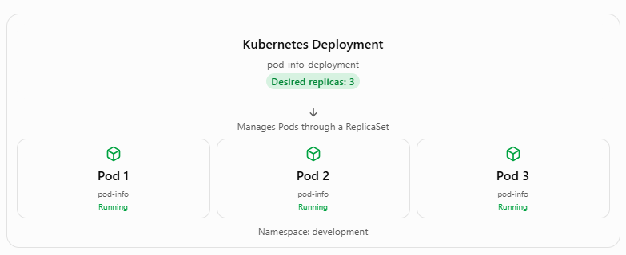
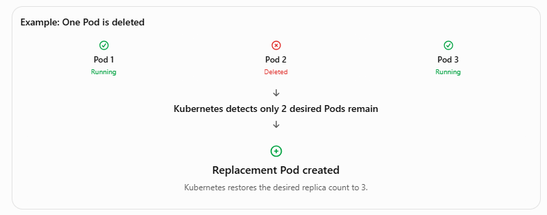

# 4.3 Deploy an applicationt

**Summary: Kubernetes Deployments and High Availability**

**1. What Is a Kubernetes Deployment?**

A Kubernetes Deployment is a resource that manages Pods and ensures the desired number of application replicas are running.

Deployments help provide high availability, meaning an application can continue running even if one of its Pods fails.

For example, if a Deployment specifies three replicas, Kubernetes attempts to maintain three running Pods.

**2. Key Benefits of Deployments**

- High Availability: Runs multiple replicas of an application.

- Self-Healing: Automatically replaces failed or deleted Pods.

- Scaling: Allows increasing or decreasing the number of Pods.

- Rolling Updates: Updates applications gradually with minimal downtime.

- Desired State: Continuously works to maintain the specified number of replicas.

**3. Kubernetes Deployment YAML Example**

A Deployment is defined using a YAML manifest file.

File: deployment.yaml

```yml

apiVersion: apps/v1
kind: Deployment

metadata:
  name: pod-info-deployment
  namespace: development

spec:
  replicas: 3

  selector:
    matchLabels:
      app: pod-info

  template:
    metadata:
      labels:
        app: pod-info

    spec:
      containers:
        - name: pod-info-container
          image: your-dockerhub-user/pod-info:latest

          ports:
            - containerPort: 3000

          env:
            - name: POD_NAME
              valueFrom:
                fieldRef:
                  fieldPath: metadata.name

            - name: POD_NAMESPACE
              valueFrom:
                fieldRef:
                  fieldPath: metadata.namespace

            - name: POD_IP
              valueFrom:
                fieldRef:
                  fieldPath: status.podIP
```


Replace your-dockerhub-user/pod-info:latest with the actual Docker image.

**Explanation of YAML Properties**

| **Property**         | **Description**                                  |
|----------------------|--------------------------------------------------|
| apiVersion: apps/v1  | Specifies the Kubernetes API version.            |
| kind: Deployment     | Creates a Deployment resource.                   |
| metadata.name        | Names the Deployment.                            |
| metadata.namespace   | Specifies the namespace.                         |
| replicas: 3          | Requests three Pods.                             |
| selector.matchLabels | Identifies Pods managed by the Deployment.       |
| template             | Defines the Pods that Kubernetes creates.        |
| containers.name      | Names the container.                             |
| image                | Specifies the Docker image.                      |
| containerPort: 3000  | Declares the container's application port.       |
| env                  | Defines environment variables for the container. |

**4. Kubernetes Deployment Architecture**



If one Pod fails, Kubernetes creates a replacement to restore the desired number of replicas.

**5. Kubernetes Commands Used in the Lesson**

Step 1: List namespaces

```bash
kubectl get ns
```

Displays all namespaces in the cluster.

Step 2: Create the development namespace

```bash
kubectl apply -f namespace.yaml
```

Creates the namespace defined in the YAML file if it does not already exist.

Step 3: Create the Deployment

```bash
kubectl apply -f deployment.yaml
```

Creates or updates the Deployment with three replicas.

Step 4: View Deployments

```bash
kubectl get deployments -n development
```

Example output:

```
NAME READY UP-TO-DATE AVAILABLE

pod-info-deployment 3/3 3 3
```

The 3/3 means three of the three desired replicas are ready.

Step 5: View Pods

```bash
kubectl get pods -n development
```

Example output:

```
NAME READY STATUS

pod-info-deployment-abc123 1/1 Running
pod-info-deployment-def456 1/1 Running
pod-info-deployment-ghi789 1/1 Running
```

Step 6: Delete a Pod to test self-healing

```bash
kubectl delete pod pod-info-deployment-abc123 -n development
```

Kubernetes automatically creates a replacement Pod because the Deployment still requires three replicas.

Step 7: Verify the replacement

```bash
kubectl get pods -n development
```

A newly created Pod should appear. It may briefly show Pending or ContainerCreating before becoming Running.

**6. How Kubernetes Self-Healing Works**



This process is managed by the Deployment's ReplicaSet controller.

**7. Deployment vs. Pod**

| **Feature** | **Pod** | **Deployment** |
|----|----|----|
| Purpose | Runs application containers | Manages application Pods |
| Replicas | One Pod resource | Can manage multiple Pods |
| Self-healing | Standalone deleted Pod is not recreated | Replaces deleted Pods |
| Scaling | Manual Pod management | Supports replica scaling |
| Rolling updates | Not directly supported | Supported |
| Production use | Usually managed by a controller | Common for stateless applications |

**Key Takeaways**

1.  Kubernetes Deployments manage Pods and help maintain application availability.

2.  The replicas property determines the desired number of Pods.

3.  Deployments automatically replace Pods that are deleted or fail.

4.  YAML manifests define Deployment configurations.

5.  The kubectl apply -f deployment.yaml command creates or updates a Deployment.

6.  The kubectl get pods -n development command displays Pods in the development namespace.

7.  A Deployment uses a ReplicaSet to maintain the desired number of Pods.

Important: Three replicas improve availability but do not guarantee uninterrupted service. Production applications also need appropriate readiness probes, traffic routing through Services, and sufficient cluster capacity.

Bottom line: A Kubernetes Deployment helps keep applications running by maintaining the desired number of Pods, automatically replacing failed Pods, and supporting scaling and updates.

# [README](./../../../README.md)
