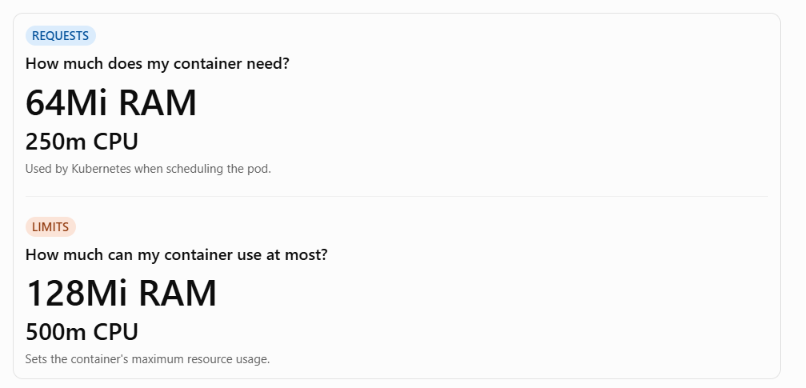

# 5.2 Add resource requests and limits to your pod

**Add Resource Requests and Limits to Your Pods**

In this lesson, we learn how to configure **CPU and memory requests and limits** for Kubernetes containers.

The goal is to prevent containers from consuming too many resources on worker nodes and causing performance problems or outages.

**1. What Are Kubernetes Resources?**

Resources refer to the CPU and memory available on a worker node.

Every container uses resources to run its application.

Without proper resource configuration:

- A pod might be scheduled on a node that doesn't have enough available resources.

- An application might consume too much CPU or memory.

- A worker node could become overloaded or fail.

- Other applications running on the same node could be affected.

**2. Resource Requests vs. Resource Limits**

Kubernetes provides two important resource settings.

**Resource Requests**

A request tells Kubernetes the minimum amount of CPU and memory to reserve for scheduling a container.

Example:

yaml

requests:

memory: "64Mi"

cpu: "250m"

This means:

- Memory: 64 mebibytes.

- CPU: 250 millicores (0.25 CPU).

Kubernetes uses these values when deciding which worker node has enough available resources to schedule the pod.

**Resource Limits**

A limit specifies the maximum amount of CPU and memory a container can use.

Example:

yaml

limits:

memory: "128Mi"

cpu: "500m"

This means:

- Memory: 128 mebibytes.

- CPU: 500 millicores (0.5 CPU).

If a container exceeds its memory limit, it can be terminated with an OOMKilled error.

If it reaches its CPU limit, Kubernetes throttles its CPU usage.

**3. How to Configure Requests and Limits in YAML**

Open your existing deployment.yaml file.

Under the container's image configuration, add a resources section.

Example:

yaml

apiVersion: apps/v1

kind: Deployment

metadata:

name: pod-info

namespace: development

spec:

replicas: 3

selector:

matchLabels:

app: pod-info

template:

metadata:

labels:

app: pod-info

spec:

containers:

\- name: pod-info

image: stefanprodan/podinfo

resources:

requests:

memory: "64Mi"

cpu: "250m"

limits:

memory: "128Mi"

cpu: "500m"

ports:

\- containerPort: 3000

The important part is:

yaml

resources:

requests:

memory: "64Mi"

cpu: "250m"

limits:

memory: "128Mi"

cpu: "500m"

**4. Understanding CPU and Memory Units**

| **Resource** | **Meaning**             |
|--------------|-------------------------|
| 64Mi         | 64 mebibytes of memory  |
| 128Mi        | 128 mebibytes of memory |
| 250m         | 0.25 CPU core           |
| 500m         | 0.5 CPU core            |
| 1000m        | 1 full CPU core         |

**Remember:**

- Mi represents mebibytes of memory.

- m represents millicores of CPU.

- 1000 millicores equals 1 CPU core.

**5. Apply the Updated Deployment**

After saving your YAML file, run:

bash

kubectl apply -f deployment.yaml

Kubernetes updates the deployment configuration.

**6. Verify the Updated Pods**

Run:

bash

kubectl get pods -n development

You'll notice:

- Old pods are terminating.

- New pods are being created.

- New pods include the updated resource requests and limits.

This happens because Kubernetes Deployment performs a rolling update when the pod template changes.

**7. Requests vs. Limits at a Glance**

| **Feature** | **Requests**                       | **Limits**               |
|-------------|------------------------------------|--------------------------|
| Purpose     | Resource allocation for scheduling | Maximum resource usage   |
| CPU         | Scheduling requirement             | CPU throttling threshold |
| Memory      | Scheduling requirement             | Memory usage ceiling     |
| Required?   | No                                 | No                       |

**Key Takeaways**

- Resource requests tell Kubernetes how much CPU and memory a container needs for scheduling.

- Resource limits prevent containers from consuming unlimited resources.

- CPU limits cause throttling when exceeded.

- Memory limits can cause containers to be terminated if exceeded.

- Resource configuration helps prevent resource exhaustion and worker node problems.

- Updating a Deployment's pod configuration causes Kubernetes to replace old pods with new ones.

**Important Commands to Remember**

| **Command** | **Purpose** |
|----|----|
| kubectl apply -f deployment.yaml | Apply resource configuration |
| kubectl get pods -n development | Check pod status |
| kubectl describe pod \<pod-name\> -n development | Inspect pod details and resource configuration |

**Final Concept to Remember**

**Main lesson:** Resource requests help Kubernetes schedule pods properly, while resource limits help prevent containers from consuming excessive resources and affecting the stability of worker nodes.

# [README](./../../../README.md)
