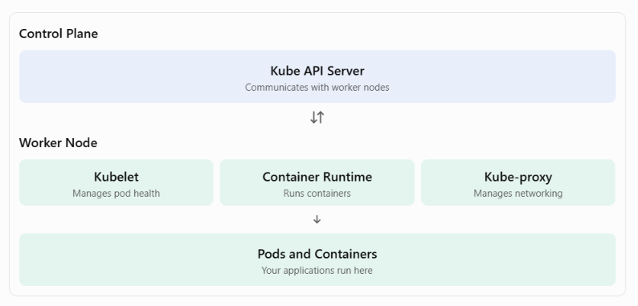

# 6.2 Kubernetes worker nodes

**Kubernetes Worker Nodes**

Kubernetes worker nodes are the machines where pods are scheduled and containers actually run.

Think of Kubernetes like an airport:

- **Control plane:** The air traffic control tower that manages the cluster.

- **Worker nodes:** The busy airport terminals where the actual activity takes place.

For high availability, many Kubernetes clusters use at least three worker nodes.

**1. Three Main Components of a Worker Node**

**1. Kubelet**

- An agent that runs on every worker node.

- Ensures containers inside pods are running and healthy.

- Communicates directly with the Kube API Server.

- Watches for newly assigned pods and makes sure they start correctly.

**Remember:** Kubelet makes sure pods and their containers are running as expected.

**2. Container Runtime**

- Responsible for starting and running containers.

- Works with the Kubelet through the Container Runtime Interface (CRI).

- Supports container runtimes such as:

  - containerd

  - CRI-O

  - Kata Containers

  - AWS Firecracker

**Important Docker concept:**

Starting with Kubernetes v1.24, Dockershim was removed.

This means Docker Engine is no longer directly supported as a Kubernetes container runtime through Dockershim.

However, Docker images still work in Kubernetes because Docker images and Docker containers are different things.

**3. Kube-proxy**

- Handles network communication between pods and services.

- Helps pods and services communicate across worker nodes.

- Communicates directly with the Kube API Server.

- Maintains networking rules that allow traffic to reach the correct destinations.

**Remember:** Kube-proxy helps manage networking and communication inside the cluster.

**2. Worker Node Components at a Glance**

| **Component**     | **Main responsibility**                 |
|-------------------|-----------------------------------------|
| Kubelet           | Ensures pods and containers are running |
| Container Runtime | Starts and runs containers              |
| Kube-proxy        | Handles network communication           |

**3. Control Plane vs. Worker Nodes**

| **Control Plane** | **Worker Nodes** |
|----|----|
| Manages the cluster | Run application workloads |
| Schedules pods | Host pods |
| Stores cluster state | Run containers |
| Monitors cluster resources | Maintain pod health |
| Includes API Server, etcd, Scheduler, Controller Manager | Includes Kubelet, Container Runtime, Kube-proxy |

**4. How the Components Work Together**

**Key Takeaways**

- Worker nodes are where Kubernetes applications actually run.

- Kubelet ensures pods and containers are running properly.

- Container Runtime starts and runs containers.

- Kube-proxy handles networking between pods and services.

- Worker nodes communicate with the control plane through the Kube API Server.

- Kubernetes supports container runtimes such as containerd and CRI-O.

**Easy way to remember:**

1.  Control Plane = The brain of Kubernetes.

2.  Kubelet = Makes sure containers are running.

3.  Container Runtime = Runs the containers.

4.  Kube-proxy = Handles networking.

5.  Worker Nodes = Where your applications run.

# [README](./../../../README.md)
