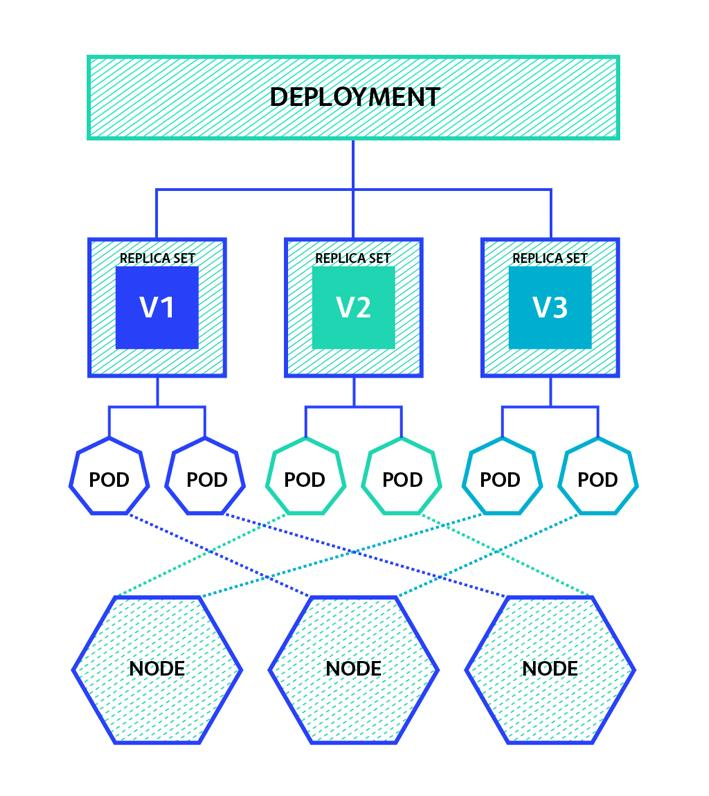
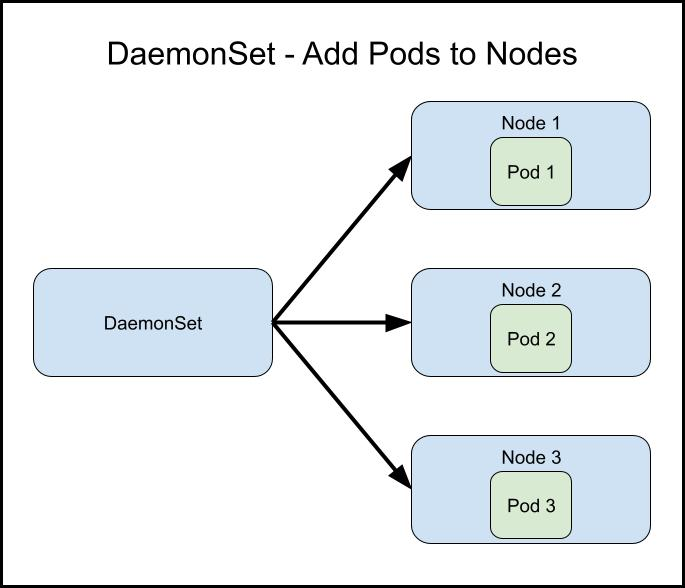
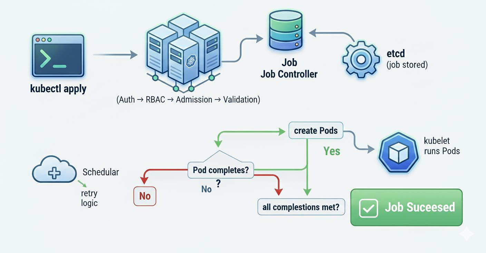

# 7.1 Ways to manage Kubernetes pods

**Ways to Manage Kubernetes Pods**

In this lesson, we learn about three Kubernetes objects used to create and manage groups of pods:

1.  Deployments

2.  DaemonSets

3.  Jobs

Each one serves a different purpose depending on how you want your application to run.

**1. Deployment**

Most commonly used

A Kubernetes Deployment is the most common way to deploy containerized applications.

**Main features:**

- Controls the number of pod replicas.

- Maintains the desired number of running pods.

- Supports application updates.

- Automatically replaces unhealthy or missing pods.

- Supports rolling updates with minimal or no downtime when configured appropriately.

**Example:**

If you configure a Deployment with three replicas, Kubernetes tries to maintain three running pods.

When updating your application:

- New pods are created.

- Kubernetes checks that the new pods are healthy.

- Old pods are gradually removed.

This process is called a **rolling update**.

**2. DaemonSet**

A DaemonSet ensures that a copy of a particular pod runs on every eligible worker node.

**Main features:**

- Automatically creates one pod per eligible node.

- You don't directly specify the replica count.

- Useful for background services and monitoring agents.

- New eligible nodes automatically receive the DaemonSet pod.

**Common examples:**

- Collecting node metrics.

- Monitoring container activity.

- Collecting application logs.

- Running networking agents.

**Remember:** DaemonSet = One copy of a pod on every eligible node.

**3. Job**

A Kubernetes Job creates one or more pods to complete a specific task.

Unlike Deployments, Jobs are designed for tasks that eventually finish.

**Main features:**

- Runs containers until a task successfully completes.

- Can create one or multiple pods.

- Tracks successful completion.

- Useful for temporary or one-time workloads.

**Example:**

Imagine you need to generate test data for an application.

You can:

1.  Create a Kubernetes Job.

2.  Run a container that generates the test data.

3.  Allow the container to finish its task.

4.  Keep the completion record or clean up the Job when it's no longer needed.

**Remember:** Job = Run a task until it completes successfully.

**4. Comparison: Deployment vs. DaemonSet vs. Job**

| **Feature** | **Deployment** | **DaemonSet** | **Job** |
|----|----|----|----|
| Purpose | Run applications | Run agents on nodes | Complete specific tasks |
| Pod replicas | Configurable | One per eligible node | Configurable |
| Runs continuously | Yes | Yes | No, completes a task |
| Supports rolling updates | Yes | Supports controlled updates | Not its primary purpose |
| Common use | Web applications | Monitoring agents | Batch processing |

**5. Easy Way to Remember**

**Deployment**

Run and maintain a specified number of application pods.

**DaemonSet**

Run a copy of a pod on every eligible worker node.

**Job**

Run pods to complete a specific task.

**Key Takeaways**

- **Deployment:** Best for applications that need to keep running.

- **DaemonSet:** Best for background agents that need to run on every eligible node.

- **Job:** Best for tasks that run until completion.

- Deployments support rolling updates, helping applications upgrade without downtime.

- DaemonSets automatically adjust when eligible nodes are added or removed.

- Jobs are useful for batch processing and one-time tasks.

**Main lesson:** Kubernetes provides different ways to manage pods depending on your workload. Use Deployments for applications, DaemonSets for node-level services, and Jobs for tasks that need to finish.

# [README](./../../../README.md)
