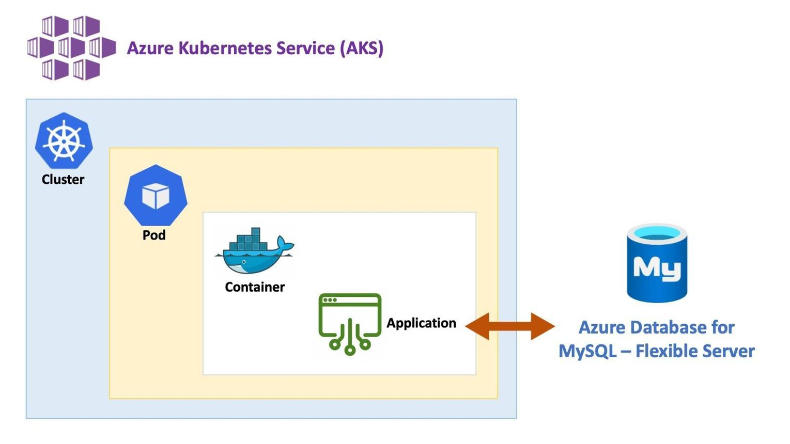
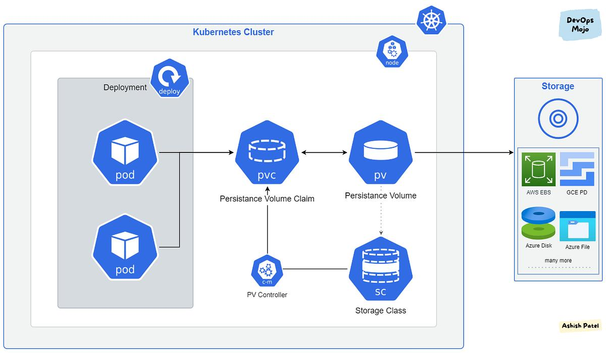

# 7.2 Running stateful workloads

**Running Stateful Workloads in Kubernetes**

In this lesson, we learn how Kubernetes handles applications that need to store data, such as applications connected to databases.

Previously, we deployed a **stateless application**, meaning it didn't need to store persistent data or communicate with a database.

Now we explore how to run **stateful applications** that need data to remain available even when pods are deleted or replaced.

**1. What Is a Stateful Workload?**

A stateful application needs to store and maintain data between application restarts.

Examples include:

- Databases (PostgreSQL, MySQL).

- Banking applications.

- E-commerce applications.

- Applications that store user information.

**Important difference:**

- Stateless application: Doesn't depend on persistent local data.

- Stateful application: Needs persistent storage to retain important data.

**2. Two Ways to Handle Data Storage in Kubernetes**

**Option 1: Use an External Database**

You can connect your Kubernetes application to a database running outside the Kubernetes cluster.

For example, your application runs inside Kubernetes while PostgreSQL runs on a separate server or managed database service.

Examples of managed database services:

- Amazon RDS

- Azure SQL

- Google Cloud SQL

**Advantages:**

- Database storage is independent of Kubernetes pods.

- Database management can be handled by a cloud provider.

- Application pods can be replaced without deleting database data.

**Option 2: Use Kubernetes Persistent Volumes**

A **Persistent Volume (PV)** is storage that exists independently of an individual pod.

This means:

- Data can remain available after a pod is deleted.

- A replacement pod can access the existing data.

- Applications can retain important information between restarts.

Kubernetes also provides an object called a **StatefulSet**.

A StatefulSet helps manage stateful applications by providing:

- Stable pod identities.

- Predictable pod creation and deletion.

- Persistent storage associations for individual pods.

This allows replacement pods to reconnect to their previously associated storage when configured correctly.

**3. External Database vs. Persistent Volume**

| **Feature** | **External Database** | **Persistent Volume** |
|----|----|----|
| Storage location | Outside Kubernetes | Storage managed through Kubernetes |
| Data persistence | Managed independently | Survives pod deletion |
| Database management | Separate server or cloud provider | You manage the database workload |
| Common use | Production databases | Stateful applications inside Kubernetes |

**4. Important Kubernetes Terms**

| **Term** | **Meaning** |
|----|----|
| Stateless | Application doesn't depend on persistent local data |
| Stateful | Application needs persistent data |
| Persistent Volume (PV) | Storage resource that exists independently of a pod |
| Persistent Volume Claim (PVC) | A request for persistent storage |
| StatefulSet | Manages stateful applications and their identities |

**Key Takeaways**

- Stateful applications need persistent storage.

- Kubernetes pods can be deleted and recreated, so important data shouldn't rely on temporary container storage.

- External databases are one way to store application data.

- Persistent Volumes allow data to survive pod deletion.

- StatefulSets help manage applications that need stable identities and persistent storage.

- Managed database services include Amazon RDS, Azure SQL, and Google Cloud SQL.

**Main lesson:** There are two primary approaches to running stateful applications in Kubernetes: connect to an external database or use Kubernetes Persistent Volumes. StatefulSets help manage applications that need consistent identities and storage across pod replacements.

# [README](./../../../README.md)
