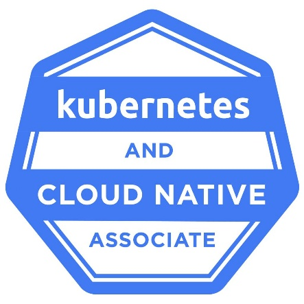
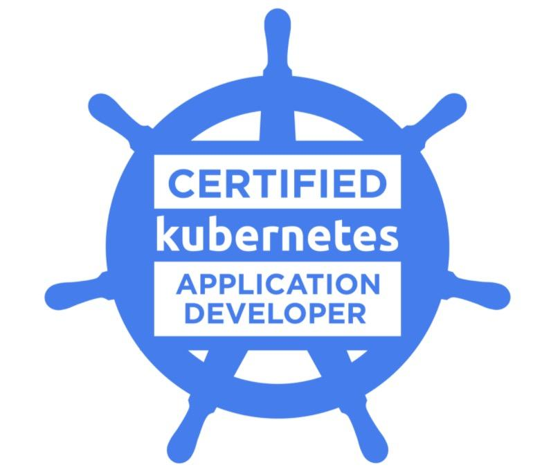
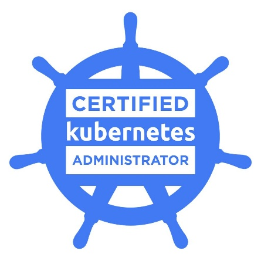

# 8.1 Next steps on your Kubernetes voyage

**Next Steps on Your Kubernetes Voyage**

In this final lesson, the instructor shares recommendations for continuing your Kubernetes learning journey and developing your cloud-native skills.

Kubernetes is an in-demand technology that can help you qualify for new job opportunities or advance your current career.

**1. Stay Updated with Kubernetes**

Kubernetes is an open-source project that is constantly evolving.

- New versions are released frequently.

- New features and improvements are introduced.

- Security updates and changes are regularly published.

**Recommendation:** Follow announcements from the Cloud Native Computing Foundation (CNCF) to stay informed about Kubernetes developments.

Website: [CNCF Official Website ](https://www.cncf.io/?utm_source=chatgpt.com)

**2. Continue Learning Kubernetes**

The instructor recommends exploring additional learning resources.

- LinkedIn Learning courses.

- The learning path called *Master Cloud-Native Infrastructure with Kubernetes*.

- Kubernetes conference presentations.

- Technical tutorials and hands-on exercises.

You can find Kubernetes conference presentations on YouTube, particularly talks from past KubeCon events.

[Cloud Native Computing Foundation YouTube Channel ](https://www.youtube.com/@CloudNativeComputingFoundation?utm_source=chatgpt.com)

**3. Practice with Kubernetes Certifications**

One of the best ways to improve your Kubernetes skills is by preparing for certification exams offered by the Linux Foundation.

The instructor recommends three certifications:

**1. KCNA – Kubernetes and Cloud Native Associate**

An entry-level certification covering Kubernetes and cloud-native fundamentals.

[KCNA Certification ](https://training.linuxfoundation.org/certification/kubernetes-cloud-native-associate/?utm_source=chatgpt.com)

**2. CKAD – Certified Kubernetes Application Developer**

Focuses on designing, building, configuring, and deploying Kubernetes applications.

[CKAD Certification ](https://training.linuxfoundation.org/certification/certified-kubernetes-application-developer-ckad/?utm_source=chatgpt.com)

**3. CKA – Certified Kubernetes Administrator**

Focuses on Kubernetes cluster administration, configuration, maintenance, and troubleshooting.

[CKA Certification ](https://training.linuxfoundation.org/certification/certified-kubernetes-administrator-cka/?utm_source=chatgpt.com)

These certifications are challenging, but preparing for them helps deepen your practical Kubernetes knowledge.

**4. Recommended Learning Resources**

| **Resource**      | **Purpose**                                 |
|-------------------|---------------------------------------------|
| CNCF              | Follow Kubernetes announcements             |
| LinkedIn Learning | Take advanced Kubernetes courses            |
| KubeCon           | Learn from industry experts                 |
| Linux Foundation  | Prepare for Kubernetes certifications       |
| YouTube           | Watch tutorials and technical presentations |

**5. Key Takeaways**

- Kubernetes is an important and in-demand cloud-native technology.

- Keep up with new Kubernetes releases and announcements.

- Continue practicing with real Kubernetes clusters.

- Explore advanced Kubernetes courses.

- Watch KubeCon presentations to learn from industry professionals.

- Consider earning KCNA, CKAD, or CKA certifications.

- Build practical experience to strengthen your career opportunities.

**Final Course Review**

Congratulations on completing your Kubernetes course!

Here are the major topics you've covered:

1.  Kubernetes fundamentals and cluster setup.

2.  Deployments, pods, and namespaces.

3.  Troubleshooting pods and viewing application logs.

4.  Testing applications using BusyBox.

5.  Kubernetes control plane and worker nodes.

6.  Services and LoadBalancer.

7.  CPU and memory requests and limits.

8.  Stateful workloads and persistent storage.

9.  Kubernetes security best practices.

10. Managing and cleaning up Kubernetes resources.

**Final lesson:** Learning Kubernetes doesn't stop when the course ends. Continue practicing, exploring advanced concepts, and building real-world projects.

Fair winds and following seas! 🚢

# [README](./../../../README.md)
