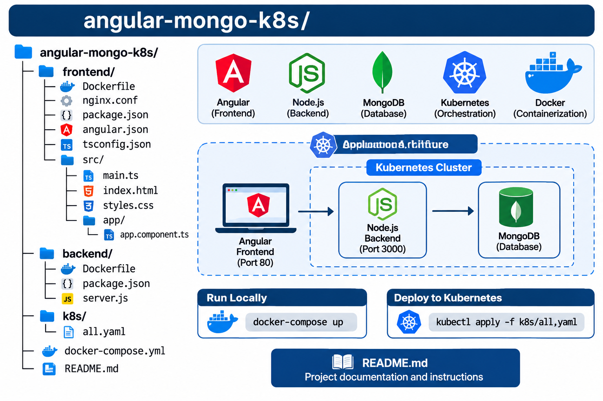

# Instructions

# **Docker and Kubernetes Project: Angular + MongoDB**

We'll build a complete example using Angular, Node.js, MongoDB, Docker, and Kubernetes.

Angular will provide the frontend, Node.js/Express will provide the REST API, and MongoDB will store the data.

## **Application architecture**

The project will support two deployment methods:

- Docker Compose: Run Angular, the API, and MongoDB locally.

- Kubernetes: Deploy the same application as Deployments, Services, a MongoDB StatefulSet, and persistent storage.

The sample application will allow you to add, view, and delete records stored in MongoDB.

## **Complete project files**

I've created the project with the Angular application, Express REST API, MongoDB configuration, Dockerfiles, Docker Compose, Kubernetes YAML, and setup instructions.

Download the complete Angular + MongoDB Docker/Kubernetes project

The project structure is:



## **Install Angular CLI globally**

Run:

```bash
npm install -g @angular/cli
```

Verify installation:
```bash
ng version
```

Recommended commands
| Command | Description |
|---|---|
| `npm install` | Install project dependencies |
| `npm install -g @angular/cli` | Install Angular CLI globally |
| `ng version` | Check Angular CLI version |
| `npx ng serve` | Start Angular without global CLI |
| `npm start` | Start application using package.json |
| `ng build` | Build Angular application |


## **How to Install Project Dependencies Using npm install for Angular Application**

The npm install command installs all dependencies required by your Node.js or Angular project.

1. Open a terminal
Navigate to your project directory.

```bash
cd frontend
```

2. Check Node.js and npm
Verify that Node.js and npm are installed:

```bash
node --version
npm --version
```

3. Install dependencies
Run:

```bash
npm install
```
This command will:
1. Read the package.json file.
2. Download the required packages and dependencies.
3. Install packages into the node_modules directory.
4. Create or update the package-lock.json file.
5. Resolve compatible package versions.

4. Verify installation
Check that dependencies were installed:

```bash
npm list --depth=0
```

5. Start your Angular application
Run:

```bash
npm start
```

Or directly:
```bash
ng serve
```

Open your browser:
http://localhost:4200

Common npm commands

| Command | Description |
|---|---|
| `npm install` | Install all dependencies |
| `npm install package-name` | Install a specific package |
| `npm install -D package-name` | Install a development dependency |
| `npm uninstall package-name` | Remove a package |
| `npm update` | Update compatible packages |
| `npm list` | List installed packages |
| `npm audit` | Check for security vulnerabilities |
| `npm cache clean --force` | Clear npm cache |


Important: Run npm install from the directory containing your package.json file.


## **Run with Docker Compose**

Open a terminal inside the extracted project directory.


```bash
docker compose up --build -d
```

Check the containers:

```bash
docker compose ps
```

Open your browser at:

[http://localhost:8080](http://localhost:8080)

You can add items, retrieve them from MongoDB, and delete them.

## **Run with Kubernetes**

The example uses kind to create a local Kubernetes cluster.

Create the cluster:

```bash
kind create cluster --name angular-mongo
```

Build both application images:

```bash
docker build -t angular-mongo-backend:1.0 ./backend

docker build -t angular-mongo-frontend:1.0 ./frontend
```

Load the images into Kubernetes:


```bash
kind load docker-image \\

angular-mongo-backend:1.0 \\

angular-mongo-frontend:1.0 \\

--name angular-mongo
```

Deploy all Kubernetes resources:

```bash
kubectl apply -f k8s/all.yaml
```

Check the Pods:

```bash
kubectl get pods -n angular-mongo
```

Wait for the frontend and backend Deployments to become ready, then expose the frontend locally:

```bash
kubectl port-forward \\

-n angular-mongo \\

service/frontend 8080:80
```

Open \*\*http://localhost:8080\*\*.

## **How the application communicates**

| **Application** | **Docker/Kubernetes name** | **Port** |
|-----------------|----------------------------|----------|
| Angular         | frontend                   | 80       |
| Node.js API     | backend                    | 3000     |
| MongoDB         | mongo                      | 27017    |

The Angular application calls /api/items. Nginx forwards these requests to the Node.js backend, which reads and writes MongoDB records.

Important: This is a local development example. It uses demonstration database credentials, which must be replaced before production deployment. The files have been generated, but I couldn't execute Docker or Kubernetes here to verify the running application.

# [README](./../../../README.md)
