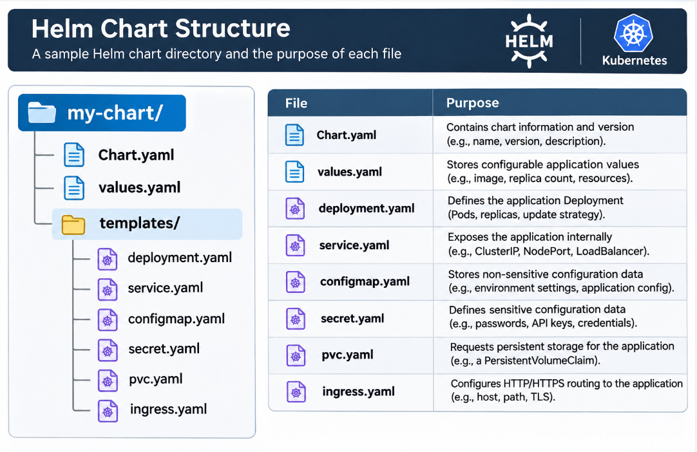
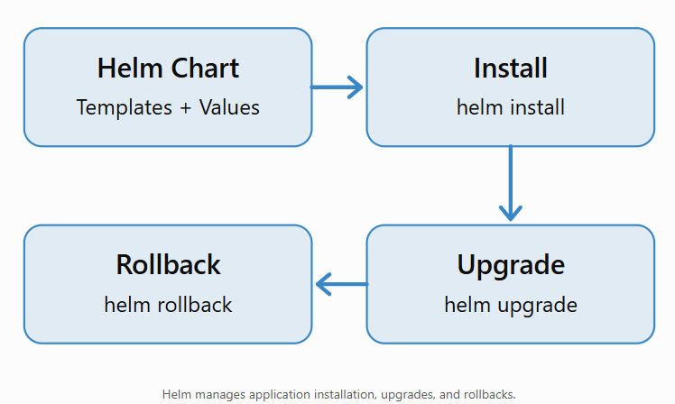

# 1.1 What is Helm

**Summary: What Is Helm in Kubernetes?**

**1. What Is Helm?**

**Helm is a package manager for Kubernetes** that simplifies installing, deploying, upgrading, and managing applications.

Just as other technologies have package managers, Kubernetes uses Helm.

| **Technology** | **Package Manager** |
|----------------|---------------------|
| Node.js        | npm, Yarn           |
| Python         | pip                 |
| Debian/Ubuntu  | apt                 |
| Kubernetes     | **Helm**            |

Helm packages Kubernetes configuration files into a reusable package called a **Helm Chart**.

**2. Why Use Helm?**

Without Helm, deploying applications requires managing multiple Kubernetes YAML files individually.

For example:

```bash

kubectl apply -f deployment.yaml

kubectl apply -f service.yaml

kubectl apply -f configmap.yaml

kubectl apply -f secret.yaml

kubectl apply -f pvc.yaml

kubectl apply -f ingress.yaml

```

With Helm, these resources can be managed using one command:

```bash

helm install my-app ./my-chart

```

**Benefits:**

- Simplifies application deployment.

- Reduces repetitive Kubernetes commands.

- Manages application versions and upgrades.

- Supports rolling back failed deployments.

- Reuses configuration across environments.

- Simplifies application lifecycle management.

**3. What Is a Helm Chart?**

A Helm Chart is a collection of files that define Kubernetes resources.

Example project structure:



| **File**        | **Purpose**                            |
|-----------------|----------------------------------------|
| Chart.yaml      | Contains chart information and version |
| values.yaml     | Stores configurable application values |
| deployment.yaml | Defines application Pods and replicas  |
| service.yaml    | Exposes the application internally     |
| configmap.yaml  | Stores non-sensitive configuration     |
| secret.yaml     | Defines sensitive configuration        |
| pvc.yaml        | Requests persistent storage            |
| ingress.yaml    | Configures HTTP/HTTPS routing          |

**4. Helm Application Lifecycle**



Helm manages application releases using commands such as:

| **Command**    | **When to Use**                     |
|----------------|-------------------------------------|
| helm install   | Install a new application release   |
| helm upgrade   | Update an existing release          |
| helm rollback  | Restore a previous release revision |
| helm list      | Display installed releases          |
| helm history   | View release history                |
| helm uninstall | Remove an installed release         |
| helm template  | Preview generated Kubernetes YAML   |

**5. Helm Templates and Values**

One of Helm's most powerful features is its **templating engine**.

Instead of hardcoding values inside Kubernetes YAML files, Helm allows you to define configurable values.

Example values.yaml:

```yaml

replicaCount: 3

image:
  repository: nginx
  tag: "1.27"

service:
  port: 80
Example deployment.yaml template:
spec:
  replicas: {{ .Values.replicaCount }}
  
```


Helm replaces {{ .Values.replicaCount }} with 3 when rendering the template.

This makes it easier to deploy the same application to development, testing, and production environments using different values files.

**6. Example: Angular and MongoDB**

For an Angular application with MongoDB storage, Helm can manage:

- Angular Deployment and Service.

- MongoDB StatefulSet and Service.

- MongoDB persistent storage using PVCs.

- Configuration and Secrets.

- Ingress for external access.

Instead of manually deploying each resource, you can use:

helm upgrade --install angular-mongo ./angular-mongo-chart

This command installs the application if it does not exist or upgrades the existing release.

**7. Key Takeaways**

**Helm makes Kubernetes application management easier by:**

1.  Packaging multiple Kubernetes YAML files into Helm Charts.

2.  Installing applications with a single command.

3.  Managing application versions and upgrades.

4.  Supporting rollbacks when deployments fail.

5.  Using templates to customize configurations.

6.  Supporting reusable deployments across environments.

**Remember:** kubectl manages Kubernetes resources, while **Helm manages application releases made up of those resources**.

# [CONTENT](./../../content.md)
