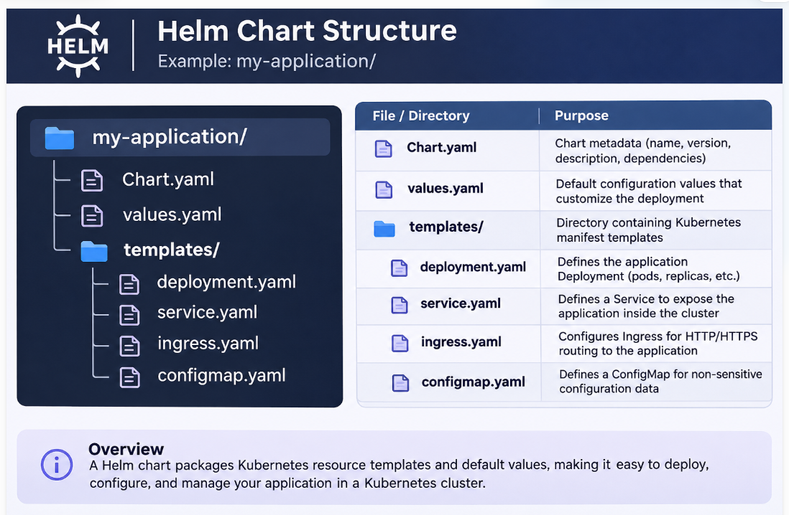
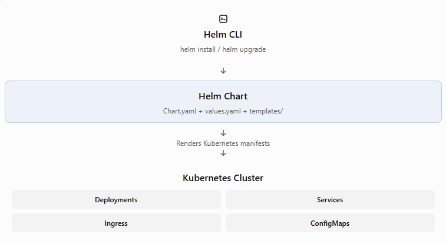

# 1.2 Helm in real life

**Helm in Real Life**

**Overview**

Helm is a package manager for Kubernetes that simplifies installing, configuring, upgrading, and managing applications using **Helm charts**.

Instead of manually managing multiple Kubernetes YAML files, Helm organizes Kubernetes resources into reusable charts and allows you to customize deployments through a values.yaml file.

In real-world Kubernetes environments, Helm has **three primary use cases**.

**1. Install and Manage Third-Party Software**

Helm makes it easier to install and maintain popular Kubernetes tools.

When creating a Kubernetes cluster, additional software is often needed for networking, security, monitoring, and application deployment.

Common examples include:

| **Tool**      | **Purpose**                                         |
|---------------|-----------------------------------------------------|
| Ingress NGINX | Routes external traffic to applications             |
| Cert-Manager  | Manages TLS/SSL certificates                        |
| Argo CD       | Provides GitOps-based continuous delivery           |
| GitLab        | Supports CI/CD workflows                            |
| Prometheus    | Monitors Kubernetes applications and infrastructure |

**Example: Install Cert-Manager using Helm**

helm repo add jetstack https://charts.jetstack.io

helm repo update


```bash

helm install cert-manager jetstack/cert-manager \
  --namespace cert-manager \
  --create-namespace \
  --set crds.enabled=true

```

This installs Cert-Manager and its required custom resource definitions.

**Benefits:**

- Simplifies installation.

- Allows configuration through Helm values.

- Supports application upgrades and rollbacks.

- Tracks installed application releases.

**2. Create and Publish Your Own Helm Charts**

Organizations can develop custom Helm charts and publish them to repositories or registries for reuse.

For example, a company managing Kubernetes clusters for multiple customers can create one standardized Helm chart and deploy it across different environments.

**Artifact Hub**

Artifact Hub helps users discover Helm charts and other cloud-native packages. It is similar to Docker Hub, but focused on discovering deployment packages rather than storing container images.

Example Helm chart structure:



| **File**        | **Purpose**                               |
|-----------------|-------------------------------------------|
| Chart.yaml      | Defines chart metadata, name, and version |
| values.yaml     | Stores customizable configuration values  |
| deployment.yaml | Defines application pods and replicas     |
| service.yaml    | Exposes the application inside Kubernetes |
| ingress.yaml    | Configures HTTP/HTTPS routing             |
| configmap.yaml  | Stores non-sensitive configuration        |

**Example: Create your own Helm chart**

```bash

helm create my-application

```

Deploy the chart:

```bash

helm install my-app ./my-application

```

Upgrade the application:


```bash

helm upgrade my-app ./my-application

```

**3. Helm Charts in Managed Kubernetes Clusters**

Managed Kubernetes services often provide preconfigured software to integrate Kubernetes with cloud infrastructure.

Examples:

| **Cloud Provider** | **Kubernetes Service**         |
|--------------------|--------------------------------|
| AWS                | Amazon EKS                     |
| Microsoft Azure    | Azure Kubernetes Service (AKS) |
| Google Cloud       | Google Kubernetes Engine (GKE) |

These environments may use Helm charts to install or manage supporting components.

Examples include cloud controllers, storage drivers, networking tools, and monitoring agents.

**Important:** Not every preinstalled component is deployed through Helm. Some are installed and managed directly by the cloud provider.

To see Helm releases in your cluster:

```bash

helm list --all-namespaces

```

This displays Helm-managed releases that your Kubernetes credentials can access.

**4. Essential Helm Commands**

| **Command**      | **Purpose**                               |
|------------------|-------------------------------------------|
| helm version     | Verify Helm installation                  |
| helm repo add    | Add a Helm chart repository               |
| helm repo update | Update repository information             |
| helm search repo | Search configured chart repositories      |
| helm create      | Generate a new Helm chart                 |
| helm install     | Install a chart                           |
| helm list        | List installed Helm releases              |
| helm upgrade     | Upgrade an existing release               |
| helm rollback    | Restore an earlier release revision       |
| helm uninstall   | Remove a release                          |
| helm template    | Render Kubernetes YAML without installing |
| helm status      | Display release status                    |

**5. How Helm Works with Kubernetes**



Helm renders the chart templates using the configured values, submits the resulting resources to Kubernetes, and tracks the release for future upgrades or rollbacks.

**6. Preparing to Use Helm**

Before continuing with the course, verify that Helm and Kubernetes are available.

**Step 1: Check Helm**

```bash

helm version

```

**Step 2: Check kubectl**

```bash

kubectl version --client

```

**Step 3: Verify Kubernetes connectivity**

kubectl cluster-info

**Step 4: Check Kubernetes nodes**

```bash

kubectl get nodes

```

**Step 5: Check installed Helm releases**

```bash

helm list -A

```

If these commands succeed and the cluster is accessible, you are ready to practice installing Helm charts.

**Key Takeaways**

1.  **Third-party software:** Helm simplifies installing and managing tools such as Cert-Manager, NGINX, and Prometheus.

2.  **Custom applications:** Developers can create reusable Helm charts for deploying their own applications.

3.  **Managed Kubernetes:** EKS, AKS, and GKE may include components deployed using Helm.

4.  **Configuration management:** values.yaml makes it easier to customize applications without rewriting Kubernetes templates.

5.  **Release management:** Helm supports installation, upgrades, release history, and rollbacks.

**Bottom line:** Helm makes Kubernetes deployments easier to standardize, reuse, maintain, and upgrade across development, testing, and production environments.

# [CONTENT](./../../content.md)
