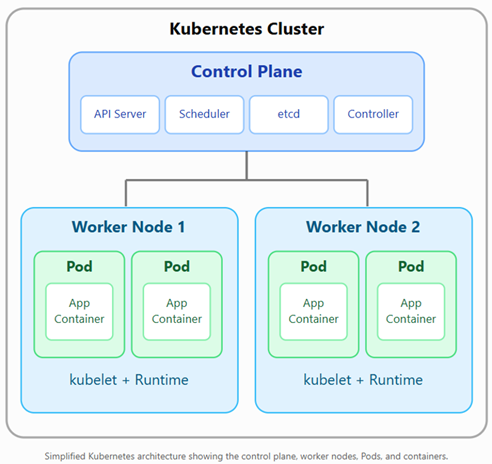
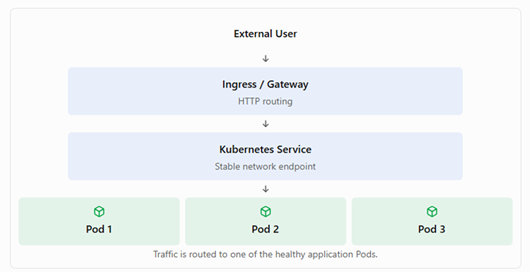

# Kubernetes-Deep-Dives


# References
* [ Learning Kubernetes | GitHub ](https://github.com/LinkedInLearning/learning-kubernetes-3212391)

---

# Learning Kubernetes Context
## 1. Introduction
 
* [ 1.1 Setting sail on your Kubernetes voyage ]( ./Learning_Kubernetes/LESSON_1/1.1_Setting_sail_on_your_Kubernetes_voyage.md )
 
* [ 1.2 What you should know ]( ./Learning_Kubernetes/LESSON_1/1.2_What_you_should_know.md )

* [ 1.3 Exercise file options ]( ./Learning_Kubernetes/LESSON_1/1.3_Exercise_file_options.md )
 
## 2. Kubernetes and the Cloud-Native Ecosystem
 
* [ 2.1 What is Kubernetes ]( ./Learning_Kubernetes/LESSON_2/2.1_What_is_Kubernetes/2.1_What_is_Kubernetes.md )
 
* [ 2.2 What are containers ]( ./Learning_Kubernetes/LESSON_2/2.2_What_are_containers/2.2_What_are_containers.md )
 
* [ 2.3 What is cloud native ]( ./Learning_Kubernetes/LESSON_2/2.3_What_is_cloud_native/2.3_What_is_cloud_native.md )

* [ 2.4 Chapter Quiz ]( ./Learning_Kubernetes/LESSON_2/2.4_Chapter_Quiz/2.4_Chapter_Quiz.md )
 
## 3. Setting Up and Getting Oriented
 
* [ 3.1 Install Docker on Windows ]( ./Learning_Kubernetes/LESSON_3/3.1_Install_Docker_on_Windows/3.1_Install_Docker_on_Windows.md )
 
* [ 3.2 Install Docker on Linux ]( ./Learning_Kubernetes/LESSON_3/3.2_Install_Docker_on_Linux/3.2_Install_Docker_on_Linux.md )
 
* [ 3.3 Install Docker on macOS ]( ./Learning_Kubernetes/LESSON_3/3.3_Install_Docker_on_macOS/3.3_Install_Docker_on_macOS.md )
 
* [ 3.4 Install minikube on Windows ]( ./Learning_Kubernetes/LESSON_3/3.4_Install_minikube_on_Windows/3.4_Install_minikube_on_Windows.md )
 
* [ 3.5 Install minikube on Linux ]( ./Learning_Kubernetes/LESSON_3/3.5_Install_minikube_on_Linux/3.5_Install_minikube_on_Linux.md )
 
* [ 3.6 Install minikube on macOS ]( ./Learning_Kubernetes/LESSON_3/3.6_Install_minikube_on_macOS/3.6_Install_minikube_on_macOS.md )
 
* [ 3.7 Spin up and explore a minikube cluster ]( ./Learning_Kubernetes/LESSON_3/3.7_Spin_up_and_explore_a_minikube_cluster/3.7_Spin_up_and_explore_a_minikube_cluster.md )

* [ 3.8 Chapter Quiz ]( ./Learning_Kubernetes/LESSON_3/3.8_Chapter_Quiz/3.8_Chapter_Quiz.md )
 
## 4. Application Deployment
 
* [ 4.1 Reading and writing YAML ]( ./Learning_Kubernetes/LESSON_4/4.1_Reading_and_writing_YAML/4.1_Reading_and_writing_YAML.md )
 
* [ 4.2 Create a namespace ]( ./Learning_Kubernetes/LESSON_4/4.2_Create_a_namespace/4.2_Create_a_namespace.md )
 
* [ 4.3 Deploy an application ]( ./Learning_Kubernetes/LESSON_4/4.3_Deploy_an_application/4.3_Deploy_an_application.md )
 
* [ 4.4 Check the health of a pod by looking at the event logs ]( ./Learning_Kubernetes/LESSON_4/4.4_Check_the_health_of_a_pod_by_looking_at_the_event_logs/4.4_Check_the_health_of_a_pod_by_looking_at_the_event_logs.md )
 
* [ 4.5 Check that your application is working with BusyBox ]( ./Learning_Kubernetes/LESSON_4/4.5_Check_that_your_application_is_working_with_BusyBox/4.5_Check_that_your_application_is_working_with_BusyBox.md )
 
* [ 4.6 View your application logs ]( ./Learning_Kubernetes/LESSON_4/4.6_View_your_application_logs/4.6_View_your_application_logs.md )
 
* [ 4.7 Challenge ]( ./Learning_Kubernetes//LESSON_4/4.7_Challenge/4.7_Challenge.md )
 
* [ 4.8 Solution ]( ./Learning_Kubernetes/LESSON_4/4.8_Solution/4.8_Solution.md )
 
## 5. Complex Application Deployment
 
* [ 5.1 Expose your application to the internet with a LoadBalancer ]( ./Learning_Kubernetes/LESSON_5/5.1_Expose_your_application_to_the_internet_with_a_LoadBalancer/5.1_Expose_your_application_to_the_internet_with_a_LoadBalancer.md )
 
* [ 5.2 Add resource requests and limits to your pod ]( ./Learning_Kubernetes/LESSON_5/5.2_Add_resource_requests_and_limits_to_your_pod/5.2_Add_resource_requests_and_limits_to_your_pod.md )
 
* [ 5.3 Delete your Kubernetes objects and tear down your cluster ]( ./Learning_Kubernetes/LESSON_5/5.3_Delete_your_Kubernetes_objects_and_tear_down_your_cluste/5.3_Delete_your_Kubernetes_objects_and_tear_down_your_cluster.md )
 
## 6. Kubernetes Architecture
 
* [ 6.1 The Kubernetes control plane ]( ./Learning_Kubernetes/LESSON_6/6.1_The_Kubernetes_control_plane/6.1_The_Kubernetes_control_plane.md )
 
* [ 6.2 Kubernetes worker nodes ]( ./Learning_Kubernetes/LESSON_6/6.2_Kubernetes_worker_nodes/6.2_Kubernetes_worker_nodes.md )
 
* [ 6.3 How the control plane and nodes work together ]( ./Learning_Kubernetes/LESSON_6/6.3_How_the_control_plane_and_nodes_work_together/6.3_How_the_control_plane_and_nodes_work_together.md )
 
* [ 6.4 Kubernetes cluster components ]( ./Learning_Kubernetes/LESSON_6/6.4_Kubernetes_cluster_components/6.4_Kubernetes_cluster_components.md )
 
## 7. Advanced Topics
 
* [ 7.1 Ways to manage Kubernetes pods ]( ./Learning_Kubernetes/LESSON_7/7.1_Ways_to_manage_Kubernetes_pods/7.1_Ways_to_manage_Kubernetes_pods.md )
 
* [ 7.2 Running stateful workloads ]( ./Learning_Kubernetes/LESSON_7/7.2_Running_stateful_workloads/7.2_Running_stateful_workloads.md )
 
* [ 7.3 Kubernetes security ]( ./Learning_Kubernetes/LESSON_7/7.3_Kubernetes_security/7.3_Kubernetes_security.md )
 
## 8. Conclusion
 
* [ 8.1 Next steps on your Kubernetes voyage ]( ./Learning_Kubernetes/LESSON_8/8.1_Next_steps_on_your_Kubernetes_voyage/8.1_Next_steps_on_your_Kubernetes_voyage.md )

---

**Common Kubernetes Terms --- Beginner\'s Guide**

Kubernetes (K8s) is an open-source container orchestration platform that
automates deploying, managing, scaling, and recovering containerized
applications.

Below are the most common Kubernetes terms, their definitions, and
practical examples.

**1. Kubernetes Core Components**


  |**Term**           | **Definition**										                             |
  |-------------------|----------------------------------------------------------------------------------|
  |Cluster            | A collection of machines running Kubernetes applications.                        |
  |Node               | A physical or virtual machine that runs workloads.                               |
  |Control Plane      | Components that manage the cluster and make scheduling decisions.                |
  |Worker Node        | A node that runs application workloads in Pods.                                  |
  |Pod                | The smallest deployable unit in Kubernetes; contains one or more containers.     |
  |Container          | A packaged application with its dependencies.                                    |
  |Image              | A read-only template used to create containers.                                  |
  |Namespace          | A logical partition used to organize Kubernetes resources.                       |
  |kubelet            | An agent on each node that ensures assigned Pods and containers are running.     |
  |Container Runtime  | Software such as containerd that runs containers.                                |
          

**2. Kubernetes Architecture**



Simplified Kubernetes architecture showing the control plane, worker
nodes, Pods, and containers.

Example: A Java application may run in three Pods distributed across two
worker nodes. Kubernetes monitors these Pods and can replace them if
they fail.

**3. Application Deployment and Scaling**

  |**Term**           | **Definition**										                             |
  |-------------------|----------------------------------------------------------------------------------|
  | Deployment      |       Manages application Pods and supports rolling updates and rollback.|
  | Replica          |      A copy of a Pod used to increase availability or capacity.|
  | ReplicaSet       |      Maintains the desired number of matching Pods.|
  | StatefulSet     |       Manages stateful applications requiring stable identities and storage.|
  | DaemonSet      |        Ensures a Pod runs on every eligible node, or selected nodes.|
  | Job         |           Runs a task to completion.|
  | CronJob          |      Runs Jobs on a recurring schedule.|
  | Rolling Update  |       Gradually replaces older Pods with newer ones.|
  | Horizontal Pod    |     Automatically adjusts the number of Pods based on metrics.|
  | Autoscaler (HPA)   |    																			|
  | Self-Healing      |     Kubernetes detects failures and replaces or restarts affected workloads.|


**Example: Deployment with three replicas**

```bash

apiVersion: apps/v1
kind: Deployment
metadata:
	name: java-app
spec:
	replicas: 3
	selector:
		matchLabels:
		app: java-app
	template:
		metadata:
			labels:
			app: java-app
		spec:
	containers:
		- name: java-container
		image: nginx:latest
		ports:
			- containerPort: 80
```

This example creates three replicas of an Nginx container, despite the
illustrative Deployment name java-app.

**4. Kubernetes Networking Terms**

  |**Term**           | **Definition**										                             |
  |-------------------|----------------------------------------------------------------------------------|
  | Service         |Provides a stable network endpoint for accessing a group of Pods. |
  | ClusterIP      | A Service type accessible inside the cluster.|
  | NodePort       | Exposes a Service on a port of each node.|
  | LoadBalancer   | Exposes a Service through an external load balancer, when supported.|
  | Ingress        | Defines HTTP/HTTPS routing rules for incoming traffic.|
  | Ingress         |Implements the routing rules defined by Ingress resources.|
  | Ingress         |Implements the routing rules defined by Ingress resources.|
  | Controller      |               											|								   
  | Gateway API    | A newer, more expressive set of APIs for traffic routing. |
  | CoreDNS         |Provides DNS-based service discovery inside Kubernetes.|
  | NetworkPolicy  | Controls allowed network traffic between Pods and other endpoints.|
  | CNI             |Container Network Interface, used by networking plugins to configure Pod networking.|
                  


**Example network flow**



Traffic is routed to one of the healthy application Pods.

**5. Kubernetes Storage Terms**

  |**Term**           | **Definition**										                             |
  |-------------------|----------------------------------------------------------------------------------|
  |Volume                  |Storage mounted into containers within a Pod.|
  |PersistentVolume (PV)   |A cluster storage resource with a lifecycle independent of a particular Pod.|
 | PersistentVolumeClaim   |A request for persistent storage by an application.|
  |(PVC)                   |        																|
  |StorageClass            |Defines a class of storage and its provisioning behavior. |                  
 | CSI                     |Container Storage Interface, allowing Kubernetes to integrate with storage systems. |                    
  |emptyDir                |Temporary storage shared by containers in a Pod, deleted when the Pod is removed from its node.|
                         


Example: A PostgreSQL database uses a PVC so its data can survive Pod
replacement.

**6. Configuration and Security**

  |**Term**           | **Definition**										                             |
  |-------------------|----------------------------------------------------------------------------------|
|  ConfigMap        | Stores non-sensitive application configuration. |
 | Secret            |Stores sensitive values such as passwords and tokens; additional encryption and access controls are recommended. |             
|  ServiceAccount    |Provides an identity for workloads interacting with Kubernetes APIs.  |              
 | RBAC              |Role-Based Access Control, governing permissions to Kubernetes resources. |
 | Role              |Defines permissions within a namespace. |
  |ClusterRole       |Defines permissions that can apply cluster-wide or to namespaced resources. |          
  | RoleBinding       |Assigns a Role or ClusterRole within a namespace. |
 | Resource Requests |CPU and memory amounts used by Kubernetes for scheduling.   |        
|  Resource Limits   |Configured maximum resource usage constraints for containers.  |    
 | SecurityContext   |Specifies security-related settings for Pods and  containers.|
                   


**7. Health, Monitoring, and Operations**

  |**Term**           | **Definition**										                             |
  |-------------------|----------------------------------------------------------------------------------|
  |Liveness    | Checks whether a container needs to be restarted.|
  |Probe        |                                    |
  |Readiness   | Checks whether a container is ready to receive traffic.|
  |Probe    |                              |     
 | Startup     | Allows slow-starting applications time to initialize. | 
  |Probe        |                                                           |
 | kubectl      |Command-line tool used to manage Kubernetes resources.|
  |Helm        | Package manager used to install and manage Kubernetes  applications.|
  |Helm Chart   |A collection of templates and configuration for deploying an application.|
  |Operator    | Software that extends Kubernetes controllers to automate application operations.|
  |CRD          |CustomResourceDefinition, used to extend the Kubernetes API with new resource types.|
  |etcd        | Distributed key-value store holding Kubernetes cluster ||
              


**8. Most Common kubectl Commands**

 
 | **Command**      |                   **Purpose** |
|-------------------|----------------------------------------------------------------------------------|
 | kubectl get pods                    |List Pods in the current namespace. |
 | kubectl get nodes                   |List cluster nodes. |
 | kubectl get deployments             |List Deployments. |
 | kubectl get services                |List Services. |
 | kubectl get namespaces             | List namespaces.|
 | kubectl describe pod my-pod         |Show detailed Pod information. |
 | kubectl logs my-pod                 |Display container logs.|
|  kubectl apply -f app.yaml           |Create or update resources from YAML.   |                       
 |  kubectl delete -f app.yaml          |Delete resources defined in YAML. |
 |  kubectl scale deployment my-app     |Scale a Deployment to five Pods. |
 |  \--replicas=5                       | 									|
 |  kubectl rollout status              |Check Deployment rollout progress. |
 | deployment/my-app                   | 									|
  | kubectl exec -it my-pod \-- /bin/sh |Open a shell in a running container, if available. |
                                      


**9. Kubernetes vs. Docker vs. Databricks**


 | **Technology**  | **Primary purpose**|
|-------------------|----------------------------------------------------------------------------------|
 |  Docker           |Build and run application containers.|
 |  Kubernetes       |Orchestrate containers across clusters.|
 |  Apache Spark     |Distributed data processing engine.|
 |  Databricks       |Managed data, analytics, and AI platform built around technologies such as Spark and Delta Lake.  |
                   


Kubernetes and Spark both distribute work across machines, but they
solve different problems. Kubernetes schedules and manages containerized
workloads, while Spark executes distributed data-processing tasks. Spark
can run on Kubernetes, and Databricks abstracts much of the underlying
infrastructure management.

**10. Top 10 Kubernetes Terms to Learn First**

For beginners and technical interviews, prioritize:

1.  Cluster --- Group of Kubernetes machines.

2.  Node --- Machine participating in the cluster.

3.  Pod --- Smallest deployable Kubernetes workload unit.

4.  Container --- Packaged application and dependencies.

5.  Deployment --- Manages stateless application replicas.

6.  Service --- Stable network access to Pods.

7.  Namespace --- Logical resource organization.

8.  ConfigMap --- Non-sensitive configuration.

9.  Secret --- Sensitive configuration data.

10. kubectl --- Kubernetes command-line interface.

Official reference: [Kubernetes Concepts
Documentation](https://kubernetes.io/docs/concepts/).
