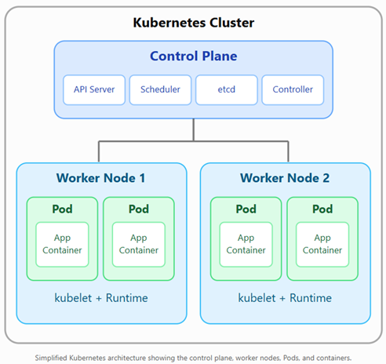
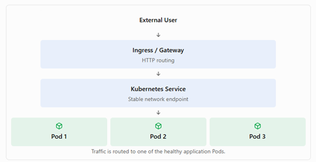

# Kubernetes-Deep-Dives

---

# Tutorials

* [Learning Kubernetes Contents](./Learning_Kubernetes/contents.md)
* [Kubernetes Your First Project Contents](./Kubernetes_Your_First_Project/context.md)

---

# Table of Contents

* [Migrate Docker Compose to Kubernetes YML File](./Table_of_Contents/Migrate_Docker_Compose_Kubernetes/Migrate_Docker_Compose_Kubernetes.md)
* [Common Kubernetes Commands](./Table_of_Contents/Common_Kubernetes_Commands/Common_Kubernetes_Commands.md)
* [Common Kubernetes Terms Beginners Guide](./Table_of_Contents/Common_Kubernetes_Terms_Beginners_Guide/Common_Kubernetes_Terms_Beginners_Guide.md)
* [Converting Docker Compose to Kubernetes](./Table_of_Contents/Converting_Docker_Compose_to_Kubernetes/Converting_Docker_Compose_to_Kubernetes.md)
* [YAML Files Explained](./Table_of_Contents/YAML_Files_Explained/YAML_Files_Explained.md)
* [What is Helm](./Table_of_Contents/What_is_Helm/What_is_Helm.md)

---

**Common Kubernetes Terms --- Beginner's Guide**

Kubernetes (K8s) is an open-source container orchestration platform that
automates deploying, managing, scaling, and recovering containerized
applications.

Below are the most common Kubernetes terms, their definitions, and
practical examples.

**1. Kubernetes Core Components**


  |**Term**           | **Definition**										                             |
  |-------------------|----------------------------------------------------------------------------------|
  |Cluster            | A collection of machines running Kubernetes applications.                        |
  |Node               | A physical or virtual machine that runs workloads.                               |
  |Control Plane      | Components that manage the cluster and make scheduling decisions.                |
  |Worker Node        | A node that runs application workloads in Pods.                                  |
  |Pod                | The smallest deployable unit in Kubernetes; contains one or more containers.     |
  |Container          | A packaged application with its dependencies.                                    |
  |Image              | A read-only template used to create containers.                                  |
  |Namespace          | A logical partition used to organize Kubernetes resources.                       |
  |kubelet            | An agent on each node that ensures assigned Pods and containers are running.     |
  |Container Runtime  | Software such as containerd that runs containers.                                |
          

**2. Kubernetes Architecture**



Simplified Kubernetes architecture showing the control plane, worker
nodes, Pods, and containers.

Example: A Java application may run in three Pods distributed across two
worker nodes. Kubernetes monitors these Pods and can replace them if
they fail.

**3. Application Deployment and Scaling**

  |**Term**           | **Definition**										                             |
  |-------------------|----------------------------------------------------------------------------------|
  | Deployment      |       Manages application Pods and supports rolling updates and rollback.|
  | Replica          |      A copy of a Pod used to increase availability or capacity.|
  | ReplicaSet       |      Maintains the desired number of matching Pods.|
  | StatefulSet     |       Manages stateful applications requiring stable identities and storage.|
  | DaemonSet      |        Ensures a Pod runs on every eligible node, or selected nodes.|
  | Job         |           Runs a task to completion.|
  | CronJob          |      Runs Jobs on a recurring schedule.|
  | Rolling Update  |       Gradually replaces older Pods with newer ones.|
  | Horizontal Pod Autoscaler (HPA)    |     Automatically adjusts the number of Pods based on metrics.| 																			|
  | Self-Healing      |     Kubernetes detects failures and replaces or restarts affected workloads.|


**Example: Deployment with three replicas**

```bash

apiVersion: apps/v1
kind: Deployment
metadata:
	name: java-app
spec:
	replicas: 3
	selector:
		matchLabels:
		app: java-app
	template:
		metadata:
			labels:
			app: java-app
		spec:
	containers:
		- name: java-container
		image: nginx:latest
		ports:
			- containerPort: 80
```

This example creates three replicas of an Nginx container, despite the
illustrative Deployment name java-app.

**4. Kubernetes Networking Terms**

  |**Term**           | **Definition**										                             |
  |-------------------|----------------------------------------------------------------------------------|
  | Service         |Provides a stable network endpoint for accessing a group of Pods. |
  | ClusterIP      | A Service type accessible inside the cluster.|
  | NodePort       | Exposes a Service on a port of each node.|
  | LoadBalancer   | Exposes a Service through an external load balancer, when supported.|
  | Ingress        | Defines HTTP/HTTPS routing rules for incoming traffic.|
  | Ingress Controller        |Implements the routing rules defined by Ingress resources.|               											|								   
  | Gateway API    | A newer, more expressive set of APIs for traffic routing. |
  | CoreDNS         |Provides DNS-based service discovery inside Kubernetes.|
  | NetworkPolicy  | Controls allowed network traffic between Pods and other endpoints.|
  | CNI             |Container Network Interface, used by networking plugins to configure Pod networking.|
                  


**Example network flow**



Traffic is routed to one of the healthy application Pods.

**5. Kubernetes Storage Terms**

  |**Term**           | **Definition**										                             |
  |-------------------|----------------------------------------------------------------------------------|
  |Volume                  |Storage mounted into containers within a Pod.|
  |PersistentVolume (PV)   |A cluster storage resource with a lifecycle independent of a particular Pod.|
 | PersistentVolumeClaim (PVC)   |A request for persistent storage by an application.|               |        																|
  |StorageClass            |Defines a class of storage and its provisioning behavior. |                  
 | CSI                     |Container Storage Interface, allowing Kubernetes to integrate with storage systems. |                    
  |emptyDir                |Temporary storage shared by containers in a Pod, deleted when the Pod is removed from its node.|
                         


Example: A PostgreSQL database uses a PVC so its data can survive Pod
replacement.

**6. Configuration and Security**

  |**Term**           | **Definition**										                             |
  |-------------------|----------------------------------------------------------------------------------|
|  ConfigMap        | Stores non-sensitive application configuration. |
 | Secret            |Stores sensitive values such as passwords and tokens; additional encryption and access controls are recommended. |             
|  ServiceAccount    |Provides an identity for workloads interacting with Kubernetes APIs.  |              
 | RBAC              |Role-Based Access Control, governing permissions to Kubernetes resources. |
 | Role              |Defines permissions within a namespace. |
  |ClusterRole       |Defines permissions that can apply cluster-wide or to namespaced resources. |          
  | RoleBinding       |Assigns a Role or ClusterRole within a namespace. |
 | Resource Requests |CPU and memory amounts used by Kubernetes for scheduling.   |        
|  Resource Limits   |Configured maximum resource usage constraints for containers.  |    
 | SecurityContext   |Specifies security-related settings for Pods and  containers.|
                   


**7. Health, Monitoring, and Operations**

  |**Term**           | **Definition**										                             |
  |-------------------|----------------------------------------------------------------------------------|
  |Liveness Probe   | Checks whether a container needs to be restarted.|                                   |
  |Readiness Probe  | Checks whether a container is ready to receive traffic.|                             |     
 | Startup  Probe   | Allows slow-starting applications time to initialize. |                                                          |
 | kubectl      |Command-line tool used to manage Kubernetes resources.|
  |Helm        | Package manager used to install and manage Kubernetes  applications.|
  |Helm Chart   |A collection of templates and configuration for deploying an application.|
  |Operator    | Software that extends Kubernetes controllers to automate application operations.|
  |CRD          |CustomResourceDefinition, used to extend the Kubernetes API with new resource types.|
  |etcd        | Distributed key-value store holding Kubernetes cluster ||
              


**8. Most Common kubectl Commands**

 
 | **Command**      |                   **Purpose** |
|-------------------|----------------------------------------------------------------------------------|
 | kubectl get pods                    |List Pods in the current namespace. |
 | kubectl get nodes                   |List cluster nodes. |
 | kubectl get deployments             |List Deployments. |
 | kubectl get services                |List Services. |
 | kubectl get namespaces             | List namespaces.|
 | kubectl describe pod my-pod         |Show detailed Pod information. |
 | kubectl logs my-pod                 |Display container logs.|
|  kubectl apply -f app.yaml           |Create or update resources from YAML.   |                       
 |  kubectl delete -f app.yaml          |Delete resources defined in YAML. |
 |  kubectl scale deployment my-app --replicas=5    |Scale a Deployment to five Pods. |									|
 |  kubectl rollout status deployment/my-app             |Check Deployment rollout progress. |
  | kubectl exec -it my-pod \-- /bin/sh |Open a shell in a running container, if available. |
                                      


**9. Kubernetes vs. Docker vs. Databricks**


 | **Technology**  | **Primary purpose**|
|-------------------|----------------------------------------------------------------------------------|
 |  Docker           |Build and run application containers.|
 |  Kubernetes       |Orchestrate containers across clusters.|
 |  Apache Spark     |Distributed data processing engine.|
 |  Databricks       |Managed data, analytics, and AI platform built around technologies such as Spark and Delta Lake.  |
                   


Kubernetes and Spark both distribute work across machines, but they
solve different problems. Kubernetes schedules and manages containerized
workloads, while Spark executes distributed data-processing tasks. Spark
can run on Kubernetes, and Databricks abstracts much of the underlying
infrastructure management.

**10. Top 10 Kubernetes Terms to Learn First**

For beginners and technical interviews, prioritize:

1.  Cluster --- Group of Kubernetes machines.

2.  Node --- Machine participating in the cluster.

3.  Pod --- Smallest deployable Kubernetes workload unit.

4.  Container --- Packaged application and dependencies.

5.  Deployment --- Manages stateless application replicas.

6.  Service --- Stable network access to Pods.

7.  Namespace --- Logical resource organization.

8.  ConfigMap --- Non-sensitive configuration.

9.  Secret --- Sensitive configuration data.

10. kubectl --- Kubernetes command-line interface.

Official reference: [Kubernetes Concepts
Documentation](https://kubernetes.io/docs/concepts/).
