# Kubernetes-Deep-Dives

---

# Tutorials

* [Learning Kubernetes Contents](./Learning_Kubernetes/contents.md)
* [Kubernetes Your First Project Contents](./Kubernetes_Your_First_Project/context.md)

---

# Table of Contents

* [Migrate Docker Compose to Kubernetes YML File](./Table_of_Contents/Migrate_Docker_Compose_Kubernetes/Migrate_Docker_Compose_Kubernetes.md)
* [Common Kubernetes Commands](./Table_of_Contents/Common_Kubernetes_Commands/Common_Kubernetes_Commands.md)
* [Common Kubernetes Terms Beginners Guide](./Table_of_Contents/Common_Kubernetes_Terms_Beginners_Guide/Common_Kubernetes_Terms_Beginners_Guide.md)
* [Converting Docker Compose to Kubernetes](./Table_of_Contents/Converting_Docker_Compose_to_Kubernetes/Converting_Docker_Compose_to_Kubernetes.md)
* [YAML Files Explained](./Table_of_Contents/YAML_Files_Explained/YAML_Files_Explained.md)
* [What is Helm](./Table_of_Contents/What_is_Helm/What_is_Helm.md)

---

# **Kubernetes Introduction**

## **1. What is Kubernetes?**

Kubernetes (K8s) is an open-source container orchestration platform used to deploy, manage, scale, and monitor containerized applications.

Kubernetes automates many tasks involved in running applications inside containers, including:

- Deploying containerized applications.

- Scaling applications up and down.

- Managing container failures.

- Distributing workloads across multiple servers.

- Managing networking between containers.

- Performing application updates without downtime.

- Managing application configuration and secrets.

Kubernetes is commonly used with Docker to run applications in production environments.

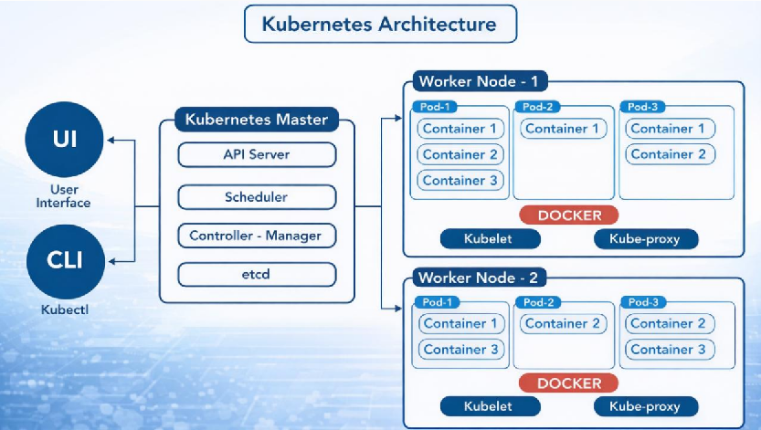

**2. Why Do We Need Kubernetes?**

Imagine you have an application built with Angular, Spring Boot, and MongoDB.

You package each application component into a Docker container.

Without Kubernetes, you must manually manage:

- Starting and stopping containers.

- Restarting failed containers.

- Scaling containers when traffic increases.

- Distributing containers across servers.

- Managing application updates.

Kubernetes automates these responsibilities.

Example:

Suppose your application needs three backend instances.

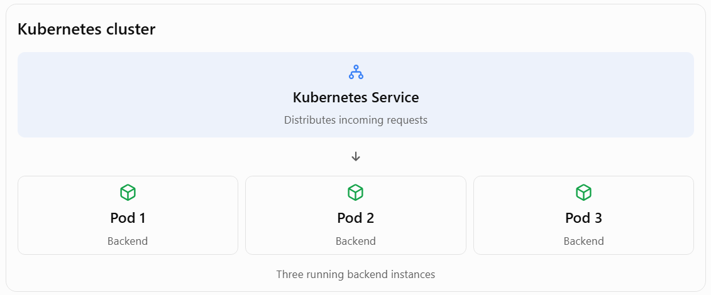

Kubernetes can automatically restart a failed Pod and maintain the desired number of replicas.

**3. Kubernetes Architecture**

A Kubernetes cluster consists of two major components:

1.  Control Plane

2.  Worker Nodes

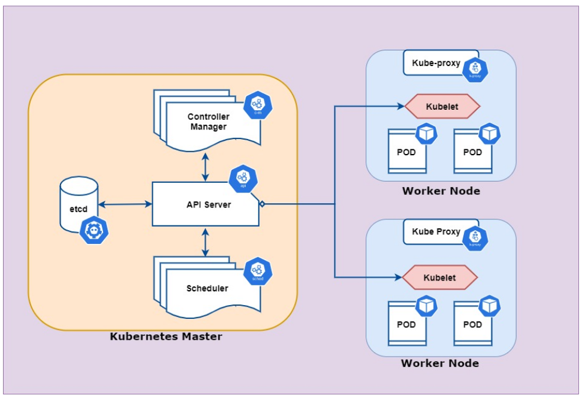

**A. Control Plane**

The Control Plane manages the Kubernetes cluster.

| **Component** | **Description** |
|----|----|
| API Server | Entry point for Kubernetes commands and API requests. |
| etcd | Stores Kubernetes cluster configuration and state. |
| Scheduler | Assigns Pods to appropriate Worker Nodes. |
| Controller Manager | Ensures the cluster maintains its desired state. |
| Cloud Controller Manager | Integrates Kubernetes with cloud provider infrastructure. |

**B. Worker Nodes**

Worker Nodes run your application containers.

| **Component** | **Description** |
|----|----|
| Kubelet | Communicates with the Control Plane and manages Pods on the node. |
| Kube-proxy | Implements Service networking rules on nodes. |
| Container Runtime | Runs containers, such as containerd or CRI-O. |
| Pods | Smallest deployable units in Kubernetes. |

**4. Important Kubernetes Objects**

These are some of the most important Kubernetes resources.

### 1. Pod

The smallest deployable unit in Kubernetes. A Pod contains one or more containers.

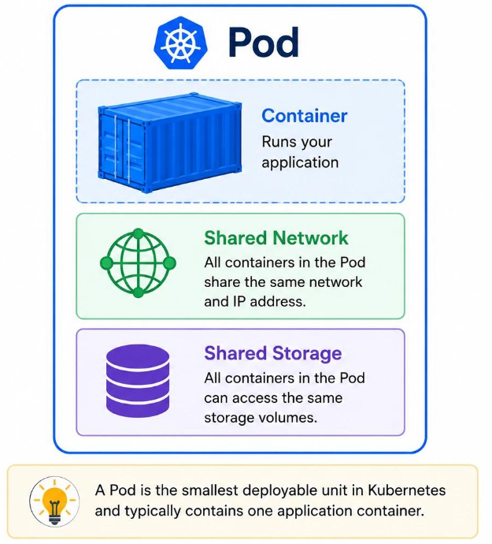

### 2. Deployment

Manages application Pods and replicas. Supports scaling and rolling updates.

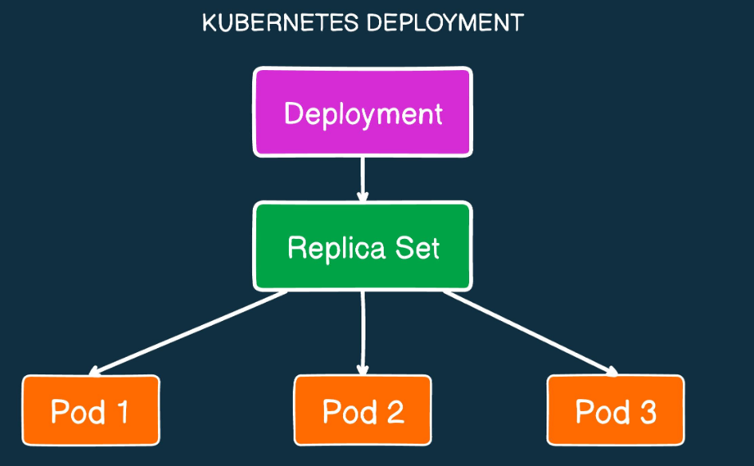

### 3. Service

Provides a stable network endpoint for accessing Pods.

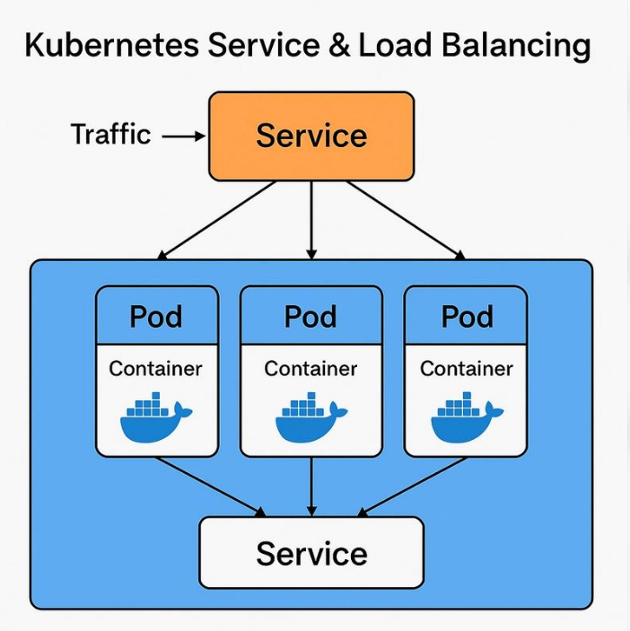

### 4. ConfigMap and Secret

Store application configuration and sensitive information, respectively.

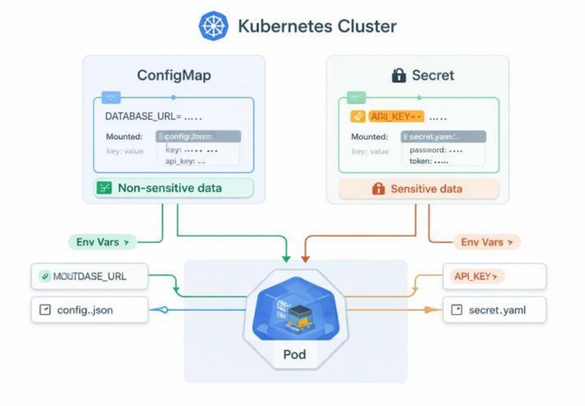

## 5. Persistent Volume (PV)

Provides persistent storage for applications.

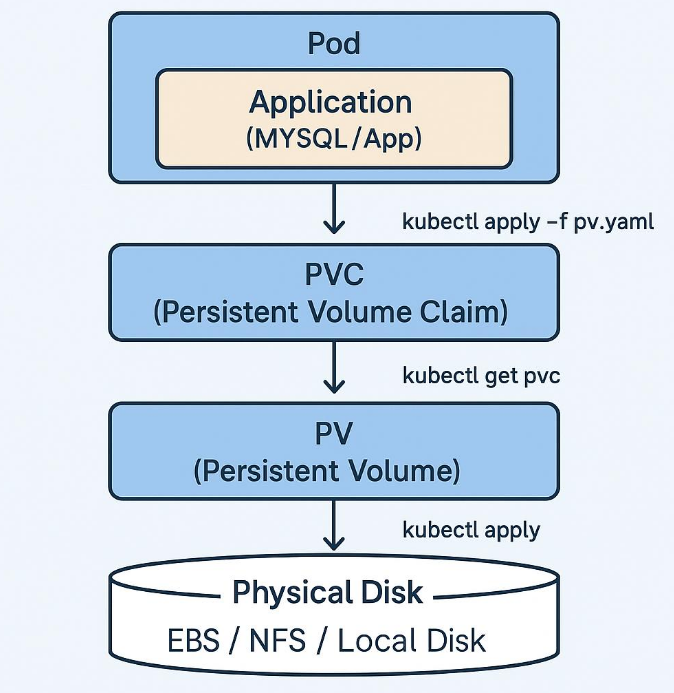

### 6. Ingress

Manages external HTTP and HTTPS access to services through an Ingress controller.

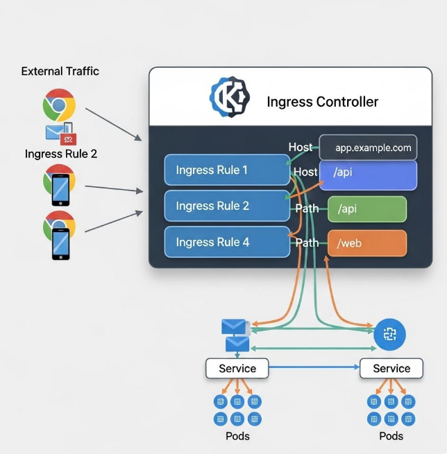

## **5. Kubernetes vs. Docker**

Docker and Kubernetes serve different purposes.

| **Feature** | **Docker** | **Kubernetes** |
|----|----|----|
| Primary purpose | Containerization | Container orchestration |
| Build images | Yes | No |
| Run containers | Yes | Through a container runtime |
| Manage containers | Individual or grouped | Across a cluster |
| Scaling | Manual or external tools | Automated and declarative |
| Load balancing | Limited built-in options | Services and networking |
| Self-healing | Limited | Yes |
| Production orchestration | Not its primary role | Yes |

Important: Docker builds container images. Kubernetes manages containerized applications across a cluster. Kubernetes does not require Docker Engine as its container runtime.

## **6. Kubernetes YAML Configuration**

Kubernetes uses YAML files to define application resources.

For example, a Deployment configuration:

```yaml
angular-deployment.yaml
apiVersion: apps/v1
kind: Deployment

metadata:
  name: angular-app

spec:
  replicas: 2

  selector:
    matchLabels:
      app: angular

  template:
    metadata:
      labels:
        app: angular

    spec:
      containers:
        - name: angular
          image: my-angular-app:1.0
          ports:
            - containerPort: 80

```

Explanation:

| **Property**  | **Description**                        |
|---------------|----------------------------------------|
| apiVersion    | Kubernetes API version.                |
| kind          | Type of Kubernetes resource.           |
| metadata      | Resource name and metadata.            |
| replicas      | Number of desired Pods.                |
| selector      | Identifies Pods managed by Deployment. |
| template      | Defines how Pods are created.          |
| containers    | Defines containers inside the Pod.     |
| image         | Docker/container image to run.         |
| containerPort | Port exposed by the container.         |

## **7. Common Kubernetes Commands**

These commands are useful when working with Minikube or Docker Desktop Kubernetes.

| **Command** | **Description** |
|----|----|
| kubectl version | Display Kubernetes client and server versions. |
| kubectl cluster-info | Display cluster information. |
| kubectl get nodes | List cluster nodes. |
| kubectl get pods | List Pods. |
| kubectl get deployments | List Deployments. |
| kubectl get services | List Services. |
| kubectl get all | Display common resources in the current namespace. |
| kubectl describe pod POD_NAME | Display detailed Pod information. |
| kubectl logs POD_NAME | Display container logs. |
| kubectl apply -f deployment.yaml | Create or update resources. |
| kubectl delete -f deployment.yaml | Delete resources defined in a file. |
| kubectl scale deployment angular-app --replicas=3 | Scale a Deployment to three replicas. |

## **8. Kubernetes Deployment Workflow**

A typical application deployment workflow looks like this:

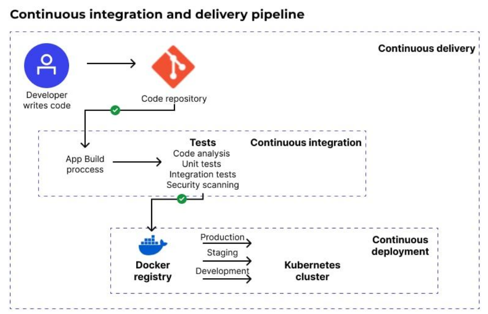

1.  Develop your application.

2.  Create a Dockerfile.

3.  Build a Docker image.

4.  Push the image to a container registry.

5.  Create Kubernetes YAML configuration files.

6.  Deploy the application using kubectl.

7.  Kubernetes creates and manages Pods.

8.  Expose the application using a Kubernetes Service or Ingress.

## **9. Kubernetes Development Tools**

| **Tool** | **Purpose** |
|----|----|
| Docker Desktop | Runs containers and provides an optional local Kubernetes cluster. |
| Minikube | Runs a local Kubernetes cluster for learning and development. |
| kubectl | Command-line tool for managing Kubernetes. |
| Helm | Kubernetes package manager. |
| K9s | Terminal-based Kubernetes management interface. |
| Kubernetes Dashboard | Web-based Kubernetes management interface. |

## **10. Learning Roadmap**

A suggested learning sequence:

1.  Container Fundamentals

Learn Docker images, containers, Dockerfiles, and Docker Compose.

2.  Kubernetes Fundamentals

Learn clusters, Control Plane, Worker Nodes, and Pods.

3.  Deployments and Services

Deploy applications and expose them using Services.

4.  Networking and Storage

Learn Ingress, ConfigMaps, Secrets, PVs, and PVCs.

5.  Application Management

Learn scaling, rolling updates, health checks, and resource limits.

6.  Advanced Kubernetes

Learn Helm, StatefulSets, DaemonSets, RBAC, monitoring, and CI/CD.

## **11. Hands-on Practice**

A good first project is a three-tier application:

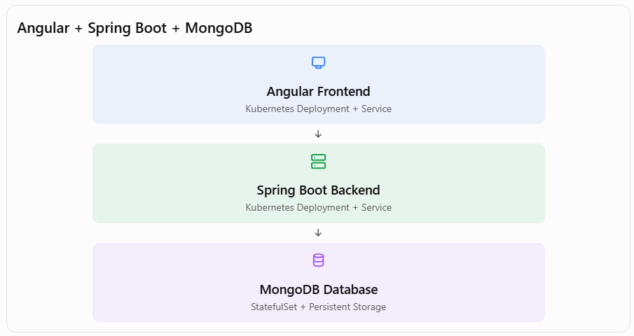

You can practice:

- Building Docker images.

- Creating Kubernetes Deployments.

- Configuring Services.

- Connecting Angular to Spring Boot.

- Connecting Spring Boot to MongoDB.

- Scaling application replicas.

- Troubleshooting Pods and application logs.

## **12. Knowledge Check**

Kubernetes Basics Quiz

0 / 5 answered

1. What is the primary purpose of Kubernetes?

A. Building Docker images

**B. Container orchestration**

C. Writing application code

**Correct B**

2. What is the smallest deployable unit in Kubernetes?

A. Node

B. Deployment

**C. Pod**

**Correct C**

3. Which Kubernetes component assigns Pods to Worker Nodes?

**A. Scheduler**

B. API Server

C. Kubelet

**Correct A**

4. Which command lists Kubernetes Pods?

A. kubectl get nodes

**B. kubectl get pods**

C. kubectl get services

**Correct B**

5. What is the purpose of a Kubernetes Service?

A. Build container images

**B. Provide stable network access to Pods**

C. Store database records

**Correct B**

**Next step:** Build a hands-on Kubernetes project using your Angular, Spring Boot, and MongoDB application, starting with Docker images and Kubernetes Deployments.

# Official Reference: 
* [Kubernetes Concepts Documentation](https://kubernetes.io/docs/concepts/).
