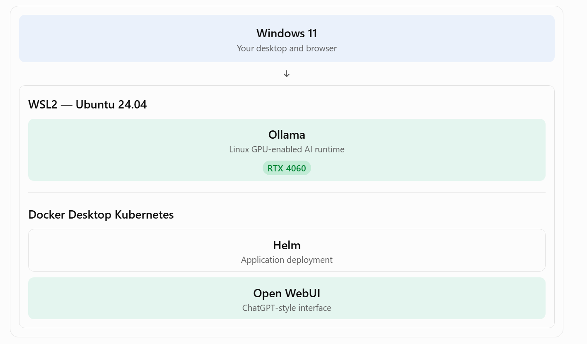

# Build your local AI Kubernetes environment

**Let's build your local AI environment**

I recommend starting with a single-node Kubernetes cluster rather than a complicated multi-node setup.

I need one important hardware detail before preparing the GPU configuration:

**What NVIDIA graphics card do you have?**

1. NVIDIA GPU model

- RTX 3060

- RTX 4060

- RTX 4070

- RTX 4080

- RTX 4090

- Other / Not sure

2. GPU memory (VRAM)

- 4 GB

- 6 GB

- 8 GB

- 12 GB

- 16 GB

- 24 GB

- Not sure

3. Operating system

Windows 11 + WSL2

Linux Ubuntu

Windows + Docker Desktop

**Build your local AI Kubernetes environment**

Based on your hardware, I recommend a **hybrid Kubernetes architecture**: run Ollama with direct NVIDIA GPU access through WSL2, and manage the ChatGPT-style web interface with Helm inside Kubernetes.

This is a better starting point than trying to force the NVIDIA GPU Operator into a Windows/WSL2 Kubernetes cluster.

**Your hardware**

**CPU**
AMD Ryzen 7 7700

**System RAM**
16 GB

**GPU**
NVIDIA RTX 4060

**GPU VRAM**
8 GB

**Operating system**
Windows 11 + WSL2

Suitable for small local AI models

Start with 3B–4B models and experiment with quantized 7B–8B models as memory permits.

**1. Architecture**



Why this architecture?

- Ollama can use your NVIDIA GPU directly.

- Kubernetes manages your web application.

- Helm manages Kubernetes deployments.

- You avoid unnecessary GPU Operator complexity on Windows.

**2. Prepare Windows 11 and WSL2**

Open **PowerShell as Administrator**.

Update WSL:

```powershell
wsl --update

wsl –shutdown
```

Start Ubuntu:

```powershell
wsl -d Ubuntu-24.04
```

Inside Ubuntu, verify NVIDIA GPU access:

```bash
nvidia-smi
```

You should see your RTX 4060 listed.

Expected GPU

NVIDIA GeForce RTX 4060

Memory: 8192 MiB

If nvidia-smi does not work, fix the Windows NVIDIA driver and WSL GPU passthrough before proceeding. Do not install a separate Linux NVIDIA display driver inside WSL.

Docker Desktop also supports NVIDIA GPU access for Linux containers through its WSL2 backend.

Docker Docs+1

**3. Configure Docker Desktop Kubernetes**

Open Docker Desktop.

1.  Go to Settings → General.

2.  Enable **Use the WSL 2 based engine**.

3.  Go to Settings → Resources → WSL Integration.

4.  Enable Ubuntu-24.04 integration.

5.  Go to Kubernetes.

6.  Enable Kubernetes.

7.  Apply and restart.

Verify Kubernetes:

```bash
kubectl config current-context

kubectl get nodes
```

You should see your Docker Desktop Kubernetes node in Ready status.

Install Helm in Ubuntu:

```bash
sudo apt update

sudo apt install -y curl wget git
```

Install Helm:

```bash
curl https://raw.githubusercontent.com/helm/helm/main/scripts/get-helm-3 | bash
```

Verify:

```bash
helm version

kubectl version
```

**4. Install Ollama with NVIDIA GPU**

For this configuration, I recommend running Ollama in a GPU-enabled Docker container outside Kubernetes. Kubernetes will manage Open WebUI.

First, verify Docker GPU support from PowerShell:

```powershell
docker run --rm --gpus all `
nvidia/cuda:12.4.1-base-ubuntu22.04 nvidia-smi
```

If this displays the RTX 4060, continue.

Create Ollama:

```bash
docker volume create ollama
```

```bash
docker run -d `
--name ollama `
--restart unless-stopped `
--gpus=all `
-p 11434:11434 `
-v ollama:/root/.ollama `
ollama/ollama
```

Verify:

```bash
docker ps
```

Download a small model:

```bash
docker exec -it ollama ollama pull qwen2.5:3b
```

Test it:

```bash
docker exec -it ollama ollama run qwen2.5:3b
```

Try asking:

Explain Kubernetes Helm charts with a simple example.

Ollama supports the RTX 4060 and NVIDIA GPU acceleration.

**5. Deploy Open WebUI using Helm**

Now we will deploy the ChatGPT-style interface in Kubernetes.

Create a namespace:

```bash

kubectl create namespace local-ai
```

Add the Open WebUI Helm repository:

```bash
helm repo add open-webui \
    https://open-webui.github.io/helm-charts
```

```bash
helm repo update
```

Create a Helm configuration file:

```bash

mkdir -p ~/local-ai

cd ~/local-ai

nano values.yaml
```

Paste this configuration:

```yaml

ollama:
  enabled: false

pipelines: 
 enabled: false

ollamaUrls:
 - "http://host.docker.internal:11434"

persistence:
 enabled: true
 size: 2Gi
 ```

Save the file.

This configuration tells Open WebUI to connect to the Ollama container instead of installing another Ollama instance inside Kubernetes. The official chart supports external Ollama endpoints.

Open WebUI+1

Install:

```bash

helm install openwebui \
   open-webui/open-webui \
   --namespace local-ai \
   --values values.yaml

```

Wait for the deployment:

```bash
kubectl get pods -n local-ai -w
```

Check services:

```bash
kubectl get services -n local-ai
```

**6. Verify the connection between Kubernetes and Ollama**

Before opening the interface, test whether Kubernetes can reach Ollama.

Run:

```bash

kubectl run ollama-test \
  --namespace local-ai \
  --rm -it \
  --restart=Never \
  --image=curlimages/curl \
  -- curl -sS <http://host.docker.internal:11434/api/tags>
``` 

Expected result: JSON containing your downloaded qwen2.5:3b model.

If this works, your Kubernetes application can reach Ollama.

If it fails, do not proceed with the WebUI connection yet; troubleshoot the Docker Desktop host networking first.

**7. Open your local ChatGPT interface**

Check the service name and port:

```bash
kubectl get svc -n local-ai
```

Then forward the service port to your computer. For a service exposing port 80:

```bash

kubectl port-forward \
  -n local-ai \
  svc/openwebui \
  3000:80
```

Use the actual service name displayed by kubectl get svc if it differs.

Open:

**Open WebUI**

Local

**localhost:3000**

Create your first account. Then select qwen2.5:3b from the model selector and start chatting.

**8. Monitor your Kubernetes environment**

Useful commands:

| **Task**            | **Command**                               |
|---------------------|-------------------------------------------|
| List pods           | kubectl get pods -n local-ai              |
| List services       | kubectl get svc -n local-ai               |
| Deployment status   | kubectl get deployments -n local-ai       |
| View WebUI logs     | kubectl logs -n local-ai deploy/openwebui |
| Helm releases       | helm list -n local-ai                     |
| Delete installation | helm uninstall openwebui -n local-ai      |

To monitor GPU usage, use PowerShell:

```powershell

nvidia-smi -l 2
```

**9. Recommended AI models for your RTX 4060**

With 8 GB VRAM and 16 GB system RAM, I would start small.

[Qwen IA - Suite de modelos de lenguaje de Alibaba Cloud](https://images.openai.com/static-rsc-4/wDD9nK6dE97GsQ5vEzRgKYoxUuxEtIY-N12SfyVm4syJFQV4zhNtaHPPwnYKpzJJMrWcA_zCmUVkSYiz21ZlAOspMgo0BNypfB9mjPG5sgkcBkIJ4e74-3-Nw3b9r9X8Z7lnKRFC3orEXKdA_8TjL4dYbsfomT7PiBz26UH2dHc?purpose=inline)

**Qwen 2.5 3B**

Recommended starting model

```bash

ollama pull qwen2.5:3b
```

Good for general questions, coding explanations and learning.

[AI Server / KI Server GPU-Server TensorRT-LLM vLLM ChatGPT openai in Köln - Lindenthal \| Grafikkarte gebraucht kaufen \| kleinanzeigen.de](https://images.openai.com/static-rsc-4/rE-INeTgyWKKi4k6aXm8mG2IkaE81PL66tSP6RHvChJaYzq-4o8V9rlw3FAFwZ28onrxCaNbVD1dNG_PnHS_Vmy-hR2SAeAP9brG5AWgIDQgJEXLV_ZuzLhROMdQD_yQO8cS0yPzyRAkrv2M1ej4kKlPVL4nIQbiZptMv8SzfGo?purpose=inline)

**Llama 3.2 3B**

```bash

ollama pull llama3.2:3b
```

Good general-purpose assistant.

[Unveiling the Potential of Gemma as Open Source LLM \| by JOAN SANTOSO \| Medium](https://images.openai.com/static-rsc-4/6_Yhk3Zv4h4NhQuSP3c1gBJyIZ2cLX04ZyD6T7SkeWVk-UDSHc6-yW-S0Vmmu0dt6FKfvjXmwxxlxHiVBTKtkCJTkXKXgTgTT72iFlAZrwalNci8IDPdmmYZSPgJZmouQrN7nB12f2UoOILp48vPgGiKeqfJOvf3Z90JC3Lfa4w?purpose=inline)

**Gemma 3 4B**

```bash

ollama pull gemma3:4b

```

Another good option for general-purpose tasks.

Larger quantized models may work with partial CPU/RAM offloading, but 7B–8B models will require more careful memory management.

**10. Your final environment**

Target installation

| **Component**   | **Installation**             |
|-----------------|------------------------------|
| Windows 11      | Host OS                      |
| Ubuntu 24.04    | WSL2                         |
| Docker Desktop  | Container runtime            |
| Kubernetes      | Docker Desktop               |
| Helm            | Kubernetes package manager   |
| Ollama          | GPU-enabled Docker container |
| Open WebUI      | Kubernetes deployment        |
| NVIDIA RTX 4060 | AI acceleration              |
| Qwen 2.5 3B     | Local language model         |

**Important:** Ollama runs outside Kubernetes in this design, but Kubernetes and Helm manage the application interface. This avoids making GPU scheduling a prerequisite for your first installation.

**Official documentation**

- [Docker Desktop NVIDIA GPU support](https://docs.docker.com/desktop/features/gpu/?utm_source=chatgpt.com)

- [Ollama GPU documentation](https://docs.ollama.com/gpu?utm_source=chatgpt.com)

- [Open WebUI Kubernetes deployment](https://docs.openwebui.com/deployment/kubernetes/?utm_source=chatgpt.com)

- [Helm documentation](https://helm.sh/docs/?utm_source=chatgpt.com)

**My recommendation:** Get Qwen 2.5 3B running first, verify GPU utilization, and then expand your Kubernetes environment with additional AI services such as document search (RAG), embeddings, and a vector database.

# [README](./../../README.md)
