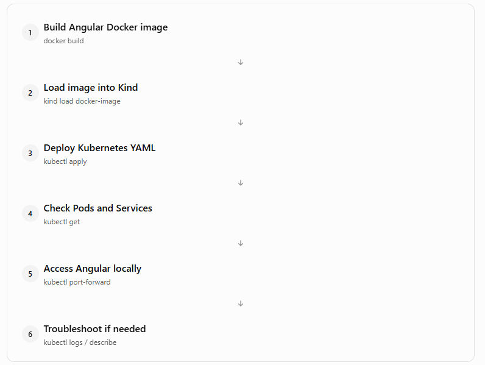

# Common Kubernetes Commands

**Common Kubernetes Commands: When and How to Use Them**

Kubernetes uses the kubectl command-line tool to create, deploy, manage, monitor, troubleshoot, and delete applications running in a Kubernetes cluster.

Below are the most common Kubernetes commands, organized by purpose, with explanations and examples using your Angular application and Kind cluster (angular-mongo).

**1. Kubernetes commands quick reference**

| **Command**                    | **When to use it**                   |
|--------------------------------|--------------------------------------|
| kubectl get pods               | Check running containers             |
| kubectl get deployments        | Check application deployments        |
| kubectl get services           | Check application networking         |
| kubectl get nodes              | Check cluster nodes                  |
| kubectl get all                | See common resources in a namespace  |
| kubectl apply -f               | Create or update resources from YAML |
| kubectl delete -f              | Delete resources defined in YAML     |
| kubectl describe pod           | Troubleshoot Pod problems            |
| kubectl logs                   | View application logs                |
| kubectl exec                   | Run commands inside containers       |
| kubectl port-forward           | Access applications locally          |
| kubectl scale                  | Increase or decrease replicas        |
| kubectl rollout restart        | Restart application Pods             |
| kubectl rollout status         | Check deployment progress            |
| kubectl rollout undo           | Roll back a deployment               |
| kubectl config current-context | Check which cluster is selected      |

**2. Cluster management commands**

Use these commands when creating or managing your local Kubernetes environment.

**Create a Kind cluster**

**bash**

kind create cluster --name angular-mongo

When: You want to create a local Kubernetes cluster for Angular and MongoDB development.

**List Kind clusters**

**bash**

kind get clusters

When: You want to see which local Kind clusters exist.

**Check the current Kubernetes context**

**bash**

kubectl config current-context

When: Before deploying, verify that kubectl is pointing to the correct cluster.

For your Kind cluster, the context is typically kind-angular-mongo.

**Switch Kubernetes context**

**bash**

kubectl config use-context kind-angular-mongo

When: You have multiple Kubernetes clusters and want to select the correct one.

**List Kubernetes nodes**

**bash**

kubectl get nodes

When: Check whether cluster nodes are running and ready.

**3. Deploy applications using YAML**

**Create or update a deployment**

**bash**

kubectl apply -f deployment.yaml

When: You create a new Angular deployment or change its YAML configuration.

**Create or update a service**

**bash**

kubectl apply -f service.yaml

When: You need networking so Kubernetes can route traffic to your Angular Pods.

**Apply all Kubernetes YAML files**

**bash**

kubectl apply -f kubernetes/

When: You want to deploy multiple resources together, such as Deployments, Services, ConfigMaps, and Secrets.

**Preview YAML changes**

**bash**

kubectl diff -f kubernetes/

When: Before applying changes, compare the YAML configuration with the live cluster. A nonzero exit code can indicate differences.

**4. View Kubernetes resources**

These commands are especially useful immediately after deploying an application.

**bash**

kubectl get pods

kubectl get deployments

kubectl get services

kubectl get all

To see additional details:

**bash**

kubectl get pods -o wide

When: Check Pod IP addresses, assigned nodes, and running status.

To continuously watch Pods:

**bash**

kubectl get pods -w

When: Monitor Pods as Kubernetes creates, restarts, or terminates them. Press Ctrl+C to stop watching.

**5. Troubleshoot Kubernetes applications**

**Describe a Pod**

**bash**

kubectl describe pod \<pod-name\>

When: A Pod is stuck in Pending, CrashLoopBackOff, or ImagePullBackOff.

This command shows container status, configuration, and recent events.

**View application logs**

**bash**

kubectl logs deployment/angular-app

When: Your Angular application crashes or does not start correctly.

Follow logs in real time:

**bash**

kubectl logs -f deployment/angular-app

**Open a terminal inside a container**

**bash**

kubectl exec -it deployment/angular-app -- /bin/sh

When: You want to inspect files, environment variables, or processes inside your Angular container.

For example, once inside:

bash

pwd

ls

printenv

**6. Access Angular from your computer**

bash

kubectl port-forward service/angular-app-service 4200:4200

When: Your Angular application is running in Kubernetes, but you want to access it through your computer.

Open:

http://localhost:4200

Port forwarding is useful for development because it does not require a public IP address or Ingress configuration.

**7. Scale and restart applications**

**Increase the number of Angular Pods**

bash

kubectl scale deployment/angular-app --replicas=3

When: You want to run three copies of your Angular application for testing or increased capacity.

**Restart a deployment**

bash

kubectl rollout restart deployment/angular-app

When: You want Kubernetes to recreate Pods, for example after rebuilding and loading an updated image.

**Check deployment progress**

bash

kubectl rollout status deployment/angular-app

When: You want to verify that a deployment or restart has completed successfully.

**Roll back a deployment**

bash

kubectl rollout undo deployment/angular-app

When: A deployment update fails and you want to restore the previous recorded deployment revision. This does not automatically restore an older image if you overwrote a mutable image tag.

**8. Manage ConfigMaps and Secrets**

**View ConfigMaps**

bash

kubectl get configmaps

When: You want to inspect which application configuration objects exist.

**View Secrets**

bash

kubectl get secrets

When: You need to verify that a Secret exists for MongoDB credentials or another application dependency.

Avoid printing Secret values in shared terminals or logs.

**9. Delete Kubernetes resources**

Delete a specific deployment:

bash

kubectl delete deployment angular-app

Delete a service:

bash

kubectl delete service angular-app-service

Delete all resources defined in your YAML folder:

bash

kubectl delete -f kubernetes/

Delete the entire Kind cluster:

bash

kind delete cluster --name angular-mongo

When: You want to remove the local development cluster. Deleting the cluster removes its Kubernetes workloads and cluster-managed data, so be careful with persistent storage.

**10. Common Angular development workflow**

Here is the sequence you will commonly use when working with Angular and Kind.

Here is the complete command sequence for your Angular project:

bash

\# 1. Create the cluster (only if it does not exist)

kind create cluster --name angular-mongo

\# 2. Build Angular image

docker build -t angular-app:v1 .

\# 3. Load image into Kind

kind load docker-image angular-app:v1 --name angular-mongo

\# 4. Update deployment.yaml to use angular-app:v1

\# Then deploy the YAML files

kubectl apply -f kubernetes/

\# 5. Verify deployment

kubectl get pods

kubectl get deployments

kubectl get services

\# 6. Check deployment status

kubectl rollout status deployment/angular-app

\# 7. View application logs

kubectl logs deployment/angular-app

\# 8. Access Angular locally

kubectl port-forward service/angular-app-service 4200:4200

The example uses the versioned image angular-app:v1. Ensure your deployment.yaml specifies that image rather than angular-app:latest. For subsequent updates, build and load a new versioned tag and update the Deployment.

**11. Practice: Which command should I use?**

Kubernetes command quiz

1\. Your Angular Pod keeps crashing. What command should you run first to view application output?

kubectl scale deployment/angular-app --replicas=3

kubectl logs deployment/angular-app

kubectl delete deployment angular-app

2\. You updated deployment.yaml. What command applies the changes?

kubectl apply -f deployment.yaml

kubectl get nodes

kubectl port-forward service/angular-app-service 4200:4200

3\. You want to open Angular at localhost:4200. Which command should you use?

kubectl get pods

kubectl rollout undo deployment/angular-app

kubectl port-forward service/angular-app-service 4200:4200

4\. You want to run three Angular replicas. Which command should you use?

kubectl scale deployment/angular-app --replicas=3

kubectl logs deployment/angular-app

kubectl describe deployment angular-app

5\. You want to check whether the Angular Deployment has finished updating. What command should you use?

kubectl get secrets

kubectl rollout status deployment/angular-app

kubectl exec -it deployment/angular-app -- /bin/sh

Score: 0/5

Reset quiz

The five commands to master first are: kubectl apply, kubectl get, kubectl describe, kubectl logs, and kubectl port-forward. Together, they cover most everyday Kubernetes development and troubleshooting tasks.

**Kubernetes Command Quiz — Answers and Explanations**

**Question 1**

Your Angular Pod keeps crashing. What command should you run first to view application output?

Correct Answer: B

bash

kubectl logs deployment/angular-app

Why: This command displays logs from your Angular application, helping you identify startup errors, missing dependencies, or application crashes.

For a container that has restarted, you can also inspect its previous logs:

bash

kubectl logs \<pod-name\> --previous

**Question 2**

You updated deployment.yaml. What command applies the changes?

Correct Answer: A

bash

kubectl apply -f deployment.yaml

Why: kubectl apply creates or updates Kubernetes resources using the configuration in your YAML file.

Use it after modifying container images, environment variables, resource limits, or other Deployment settings.

**Question 3**

You want to open Angular at localhost:4200. Which command should you use?

Correct Answer: C

bash

kubectl port-forward service/angular-app-service 4200:4200

Why: Port forwarding connects your computer's port 4200 to your Angular application running inside Kubernetes.

Then open:

[http://localhost:4200](http://localhost:4200?utm_source=chatgpt.com)

**Question 4**

You want to run three Angular replicas. Which command should you use?

Correct Answer: A

bash

kubectl scale deployment/angular-app --replicas=3

Why: Kubernetes adjusts the Deployment to maintain three Angular Pods.

Verify the replicas:

bash

kubectl get pods

kubectl get deployments

Note that a later kubectl apply may reset the replica count if your YAML specifies a different value.

**Question 5**

You want to check whether the Angular Deployment has finished updating. What command should you use?

Correct Answer: B

bash

kubectl rollout status deployment/angular-app

Why: This command monitors the Deployment rollout and reports whether the updated Pods have become ready.

It is useful after changing an image or restarting a Deployment.

**Answer key**

| **Question** | **Correct answer** | **Command**            |
|--------------|--------------------|------------------------|
| 1            | B                  | kubectl logs           |
| 2            | A                  | kubectl apply -f       |
| 3            | C                  | kubectl port-forward   |
| 4            | A                  | kubectl scale          |
| 5            | B                  | kubectl rollout status |

Remember these five concepts:

- Logs = Troubleshoot application output.

- Apply = Create or update Kubernetes resources.

- Port-forward = Access applications locally.

- Scale = Change the number of Pods.

- Rollout status = Verify deployment updates.

# [README](./../../../README.md)
