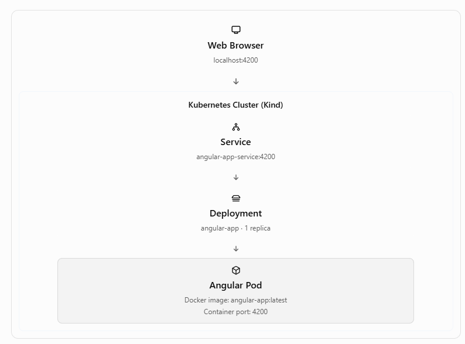
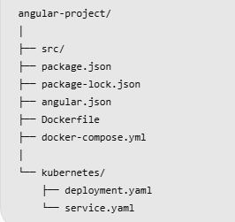

# Converting Docker Compose to Kubernetes

docker-compose.yaml

```yaml
version: '3.9'

services:
  angular-app:
    build:
      context: .
      dockerfile: Dockerfile

    container_name: angular-app

    ports:
      - "4200:4200"

    volumes:
      - .:/app
      - /app/node_modules

    command: npm start -- --host 0.0.0.0

    environment:
      - CHOKIDAR_USEPOLLING=true
```

You can convert your Docker Compose version: '3.9' configuration into Kubernetes using two main YAML files:

1.  deployment.yaml — Creates and runs your Angular application container.

2.  service.yaml — Exposes your Angular application on port 4200.

Your Docker Compose configuration uses a bind mount for development. Kubernetes handles this differently, so the following example assumes your Angular application is included in the Docker image.

**1. deployment.yaml**

This file defines your Angular application container, environment variables, ports, and startup command.

```yaml
apiVersion: apps/v1
kind: Deployment

metadata:
  name: angular-app
  labels:
    app: angular-app

spec:
  replicas: 1

  selector:
    matchLabels:
      app: angular-app

  template:
    metadata:
      labels:
        app: angular-app

    spec:
      containers:
        - name: angular-app
          image: angular-app:latest
          imagePullPolicy: IfNotPresent

          ports:
            - containerPort: 4200

          command: ["npm"]
          args:
            - "start"
            - "--"
            - "--host"
            - "0.0.0.0"

          env:
            - name: CHOKIDAR_USEPOLLING
              value: "true"
```


Explanation:

| **Kubernetes setting** | **Purpose** |
|----|----|
| replicas: 1 | Runs one Angular container |
| image: angular-app:latest | Uses your Angular Docker image |
| containerPort: 4200 | Angular application port |
| command and args | Runs npm start -- --host 0.0.0.0 |
| CHOKIDAR_USEPOLLING | Enables polling for file changes |
| imagePullPolicy: IfNotPresent | Uses a locally available image when possible |

**2. service.yaml**

This file makes your Angular application accessible through Kubernetes networking.

```yaml
apiVersion: v1
kind: Service

metadata:
  name: angular-app-service

spec:
  type: ClusterIP

  selector:
    app: angular-app

  ports:
    - name: http
      protocol: TCP
      port: 4200
      targetPort: 4200
```

The ClusterIP service exposes Angular inside the Kubernetes cluster. You can access it from your computer using port forwarding.

**3. Docker Compose vs. Kubernetes**

| **Docker Compose** | **Kubernetes equivalent** |
|----|----|
| services.angular-app | Deployment |
| build.context: . | Build Docker image separately |
| dockerfile: Dockerfile | Used during Docker build |
| container_name | Container name |
| ports: 4200:4200 | Service and container port |
| volumes: .:/app | Development bind mount; requires separate setup |
| volumes: /app/node_modules | Dependencies included in image |
| command: npm start... | command and args |
| environment | env |

Important: The Compose volumes are not directly replicated here. Kubernetes does not automatically synchronize your local source code into a Pod. For live development, you can use tools such as Skaffold or Tilt, or configure a development-specific volume setup.

**4. Build and deploy using Kind Kubernetes**

Since you are using Kind, you can build the Angular Docker image and load it into your local Kubernetes cluster.

## Step 1 — Build Docker image

```bash

docker build -t angular-app:latest .
```

## Step 2 — Load image into Kind cluster

```bash

kind load docker-image angular-app:latest --name angular-mongo
```

## Step 3 — Deploy Angular application

```bash

kubectl apply -f deployment.yaml

kubectl apply -f service.yaml
```

## Step 4 — Verify deployment

```bash

kubectl get deployments

kubectl get pods

kubectl get services
```

## Step 5 — Access Angular application

```bash

kubectl port-forward service/angular-app-service 4200:4200

```

Open your browser:

http://localhost:4200

**5. Kubernetes architecture**



**6. Recommended project structure**



With this folder structure, deploy using:

```bash

kubectl apply -f kubernetes/

```

Note: These files run Angular's development server, matching your Docker Compose command. For production, it is generally better to build Angular into static files and serve them through Nginx.

# [README](./../../README.md)
