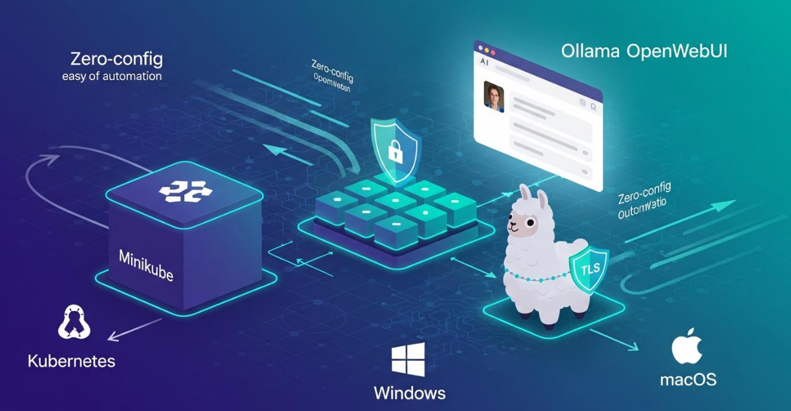
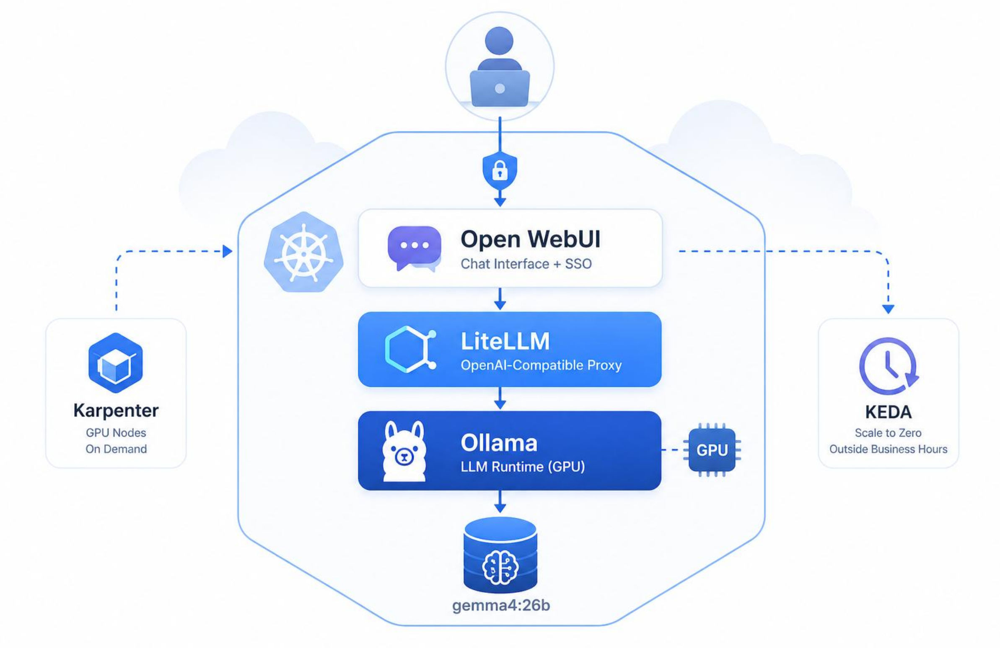

# Helm and Kubernetes to set up a local AI environment

You can use **Helm and Kubernetes to set up a local AI environment** on your Windows computer using Docker Desktop and WSL2.

Helm is particularly useful because it lets you deploy AI applications, models, databases, and supporting services into Kubernetes using reusable Helm charts.

You can build a local AI platform similar to a small private AI cloud.

**1. Recommended local AI architecture**

I recommend starting with **Ollama + Open WebUI + Kubernetes + Helm**.



| **Component**      | **Purpose**                          |
|--------------------|--------------------------------------|
| Kubernetes         | Container orchestration              |
| Helm               | Install and manage applications      |
| Ollama             | Run local AI language models         |
| Open WebUI         | Web interface for chatting with AI   |
| Docker             | Container runtime                    |
| Persistent Volumes | Store AI models and application data |

**2. Install Open WebUI using Helm**

Assuming you are using Docker Desktop Kubernetes, start by checking your cluster:

```bash

kubectl config current-context

kubectl get nodes

helm version

```

Create a namespace:

```bash

kubectl create namespace ai

```

Add the Helm repository:

```bash

helm repo add open-webui https://open-webui.github.io/helm-charts

```

helm repo update

Install Open WebUI:

```bash

helm install openwebui open-webui/open-webui -n ai

```

This chart can deploy Open WebUI, Ollama, and supporting services using its default configuration.

Open WebUI+1

**3. Verify your AI deployment**

Check your Kubernetes resources:

```bash

kubectl get pods -n ai

kubectl get deployments -n ai

kubectl get services -n ai

kubectl get pvc -n ai

```

Wait until the pods are ready.

To access the application:

```bash
kubectl port-forward -n ai service/openwebui 3000:80
```

Open your browser:

Local AI Web Interface

[http://localhost:3000](http://localhost:3000?utm_source=chatgpt.com)

**4. Download an AI model**

Ollama supports several open models, including Llama, Gemma, and Qwen.

For example, download Llama 3.2:

```bash

kubectl get pods -n ai
```

Find the Ollama pod, then run:

```bash

kubectl exec -it -n ai \<ollama-pod-name\> -- ollama pull llama3.2
```

You can then select the downloaded model in Open WebUI.

**5. Future AI architecture**

Once the basic installation works, you can expand your Kubernetes environment:

| **Technology**   | **Purpose**            |
|------------------|------------------------|
| Ollama           | Local LLM inference    |
| Open WebUI       | AI chat interface      |
| LangChain        | Build AI applications  |
| Qdrant           | Vector database        |
| PostgreSQL       | Relational database    |
| Jupyter Notebook | AI/ML development      |
| Hugging Face     | Access open AI models  |
| n8n              | AI workflow automation |



**6. One important consideration: computer hardware**

Kubernetes manages your AI containers, but the actual AI model requires RAM and processing power.

For local development, CPU inference is possible. A compatible GPU can significantly improve performance.

# [README](./../../../README.md)
