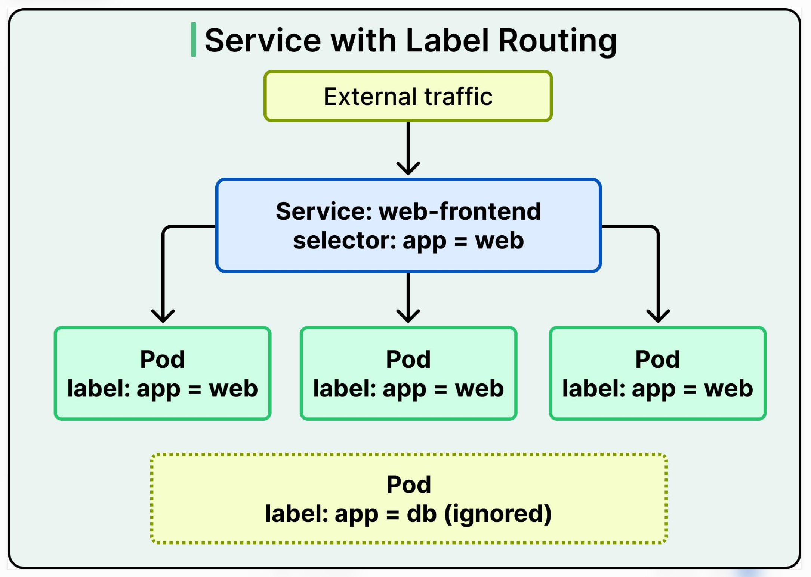
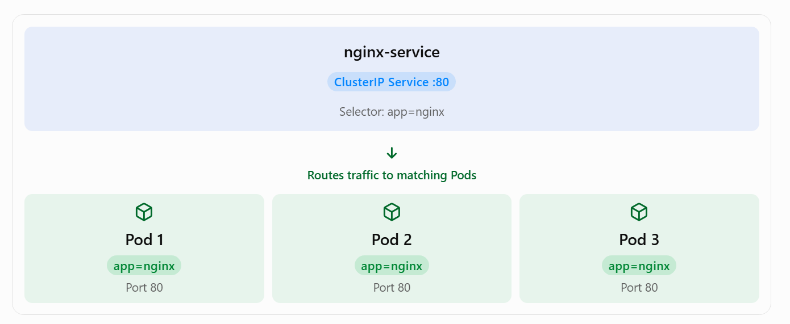

# How Kubernetes connects Pods to a Service

In Kubernetes, **Services connect to Pods using Labels and Selectors.** A Service provides a stable IP address and DNS name, allowing other Pods or applications to communicate with your Pods.

Let's walk through how it works with a practical example.

**1. How Kubernetes connects Pods to a Service**



The connection works like this:

1.  A Pod has labels.

2.  A Service has a selector.

3.  Kubernetes matches the Service selector with Pod labels.

4.  The Service automatically routes traffic to matching Pods.

**Important:** The Service does not connect to a Pod by its name or IP address. It uses labels.

**2. Create Pods with labels**

Create a file named deployment.yaml.

```yaml
apiVersion: apps/v1
kind: Deployment
metadata:
  name: nginx-deployment
spec:
  replicas: 3
  selector:
    matchLabels:
      app: nginx
  template:
    metadata:
      labels:
        app: nginx
    spec:
      containers:
        - name: nginx
          image: nginx:latest
          ports:
            - containerPort: 80
```

Notice this section:

```yaml

labels:
app: nginx

```

All three Pods receive the label app: nginx.

Apply the deployment:

```bash

kubectl apply -f deployment.yaml

```

Check the Pods:

```bash

kubectl get pods --show-labels

```

**3. Create a Kubernetes Service**

Create service.yaml.

```yaml

apiVersion: v1
kind: Service
metadata:
  name: nginx-service
spec:
  type: ClusterIP
  selector:
    app: nginx
  ports:
    - protocol: TCP
      port: 80
      targetPort: 80

```

**The important part is:**

```yaml
selector:
    app: nginx
```

This matches the Pod label:

```yaml
labels:
    app: nginx
```

Apply the Service:

```bash

kubectl apply -f service.yaml

```

**4. Verify the connection**

Check your Service:

```bash

kubectl get services

```

Check which Pods the Service connects to:

```bash

kubectl get endpoints nginx-service

```

Or use:

```bash

kubectl get endpointslices

```

You should see the IP addresses of the three Pods.

**5. Test communication with the Service**

Create a temporary test Pod:

```bash
kubectl run test-client \
  --image=busybox:1.36 \
  -it --rm \
  --restart=Never \
  -- wget -qO- http://nginx-service
```


You should receive the Nginx welcome page HTML.

Kubernetes also provides DNS automatically.

You can access the Service using:

http://nginx-service

From another namespace:

http://nginx-service.default.svc.cluster.local

**6. Understand the connection visually**



**7. Important Kubernetes Service types**

| **Service type** | **Purpose**                                           |
| ---------------- | ----------------------------------------------------- |
| ClusterIP        | Internal communication between Pods                   |
| NodePort         | Exposes application through a node port               |
| LoadBalancer     | Exposes application through an external load balancer |
| ExternalName     | Maps a Service to an external DNS name                |

**8. Useful Kubernetes commands**

| **Command**                         | **Purpose**               |
| ----------------------------------- | ------------------------- |
| kubectl get pods                    | List Pods                 |
| kubectl get svc                     | List Services             |
| kubectl get pods --show-labels      | Display Pod labels        |
| kubectl describe svc nginx-service  | Inspect Service           |
| kubectl get endpoints nginx-service | Display connected Pod IPs |
| kubectl get endpointslices          | Inspect endpoint slices   |
| kubectl get pods -o wide            | Display Pod IP addresses  |

**The most important concept to remember:**

Pod LABELS <----> Service SELECTOR

Kubernetes uses this matching mechanism to automatically discover Pods and distribute traffic.

**Next step:** I can show you how to connect two different applications, such as a Spring Boot application Pod connecting to a MySQL database Pod using Kubernetes Services.

# [README](./../../../README.md)
