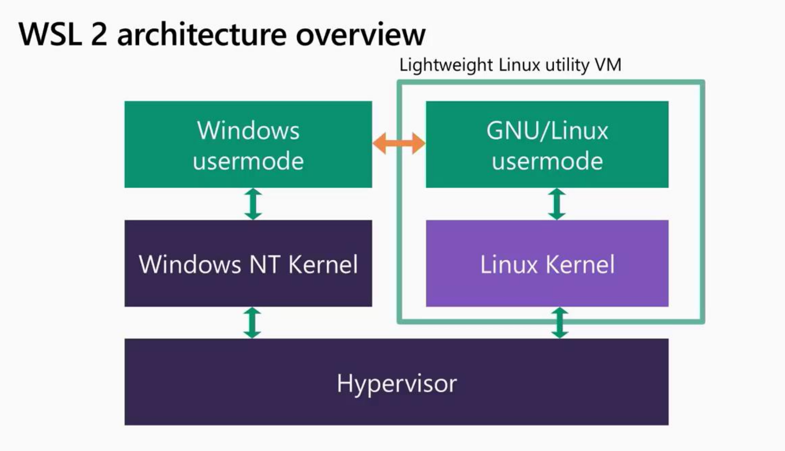
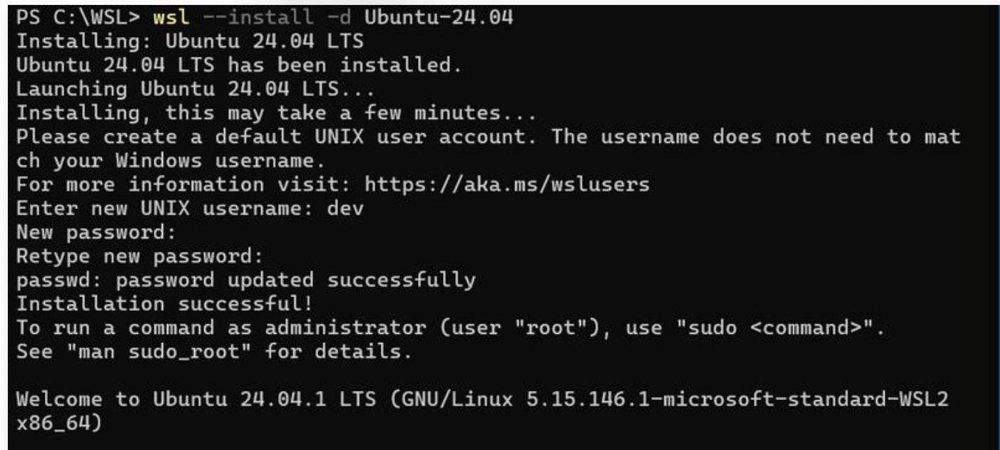
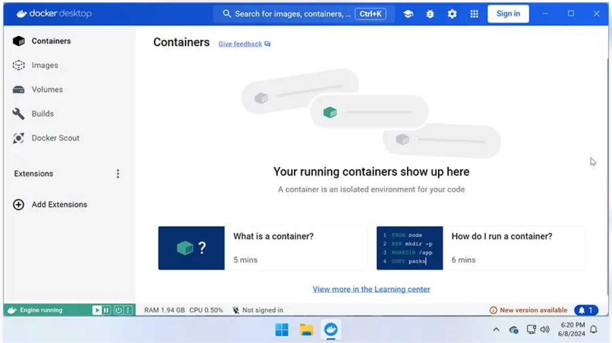
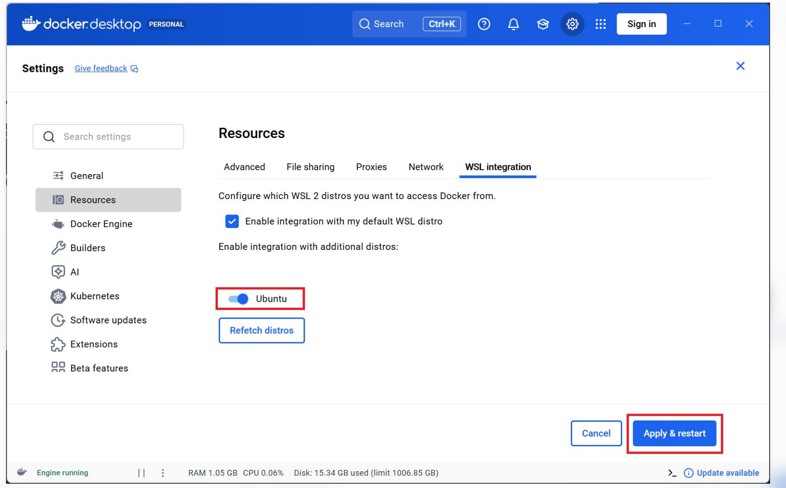
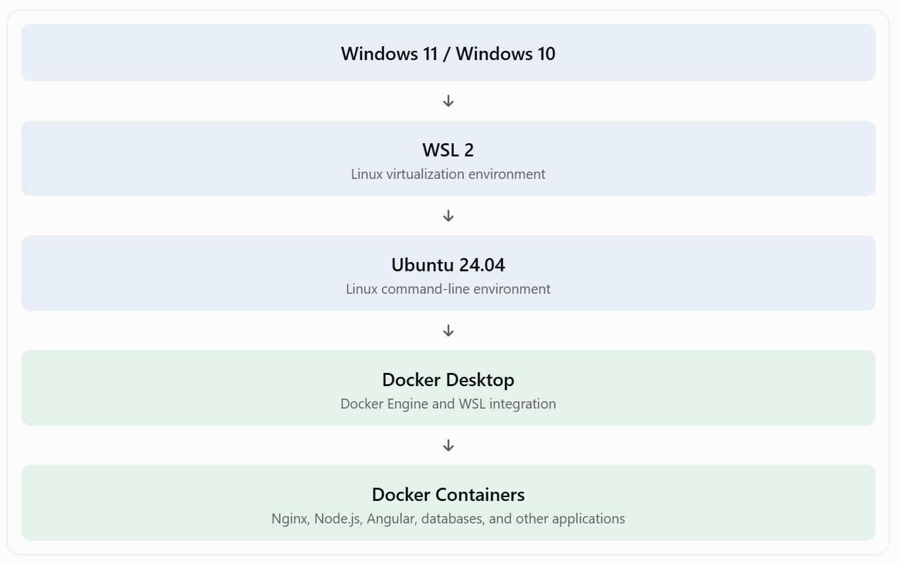

# Install WSL Docker Desktop

# The intended guide covers:

1.  Installing WSL 2 on Windows.

2.  Installing Ubuntu 24.04.

3.  Updating and verifying WSL.

4.  Installing Docker Desktop.

5.  Configuring Docker Desktop WSL integration.

6.  Testing Docker from PowerShell and Ubuntu.

7.  Troubleshooting Docker access and startup problems.

# Introduction to Windows Subsystem for Linux (WSL 2)

**Windows Subsystem for Linux 2 (WSL 2)** is a feature of Microsoft Windows that allows you to run a Linux environment directly on your Windows computer without installing a separate virtual machine or setting up a dual-boot system.

WSL 2 uses a lightweight virtual machine powered by Microsoft's Hyper-V virtualization technology to run a real Linux kernel. This provides better compatibility with Linux applications, development tools, and system commands.

With WSL 2, developers can use Linux distributions such as Ubuntu alongside Windows applications and tools.

**Key Benefits of WSL 2**

1.  **Linux Environment:** Run Linux distributions, such as Ubuntu, directly on Windows.

2.  **Linux Kernel:** Uses a real Linux kernel for improved compatibility.

3.  **Development Tools:** Run Linux commands, Bash scripts, Python, Node.js, Git, and other development tools.

4.  **Docker Integration:** Works with Docker Desktop to run Linux containers.

5.  **Resource Management:** Configure memory, CPU, and swap resources.

6.  **Windows Integration:** Access Windows files and applications from Linux and vice versa.



**WSL 2 vs. Traditional Virtual Machines**

| **Feature**         | **WSL 2**         | **Traditional VM**     |
|---------------------|-------------------|------------------------|
| Linux kernel        | Real Linux kernel | Real Linux kernel      |
| Installation        | Simple            | More setup             |
| Resource usage      | Lightweight       | Typically higher       |
| Windows integration | Built-in          | Requires configuration |
| Linux distributions | Multiple          | Multiple               |
| Docker support      | Excellent         | Requires configuration |

**WSL 2 and Docker Desktop**

WSL 2 is particularly useful for developers working with Docker Desktop. It provides the Linux environment required to run Linux containers on Windows.

A typical development environment looks like this:

- **Windows 11:** Host operating system.

- **WSL 2:** Linux virtualization environment.

- **Ubuntu 24.04:** Linux distribution.

- **Docker Desktop:** Container management platform.

- **Docker Engine:** Runs and manages containers.

**In summary:** WSL 2 provides a convenient way to use Linux development tools on Windows. Combined with Ubuntu and Docker Desktop, it creates a powerful development environment for building, testing, and deploying applications.

# Install WSL 2, Ubuntu 24.04, and Docker Desktop on Windows

This guide explains how to install and configure Windows Subsystem for Linux (WSL 2), Ubuntu 24.04, and Docker Desktop on Windows 10/11. It also includes verification commands and troubleshooting steps.

**1. Install WSL 2 on Windows**

WSL (Windows Subsystem for Linux) allows you to run a Linux environment directly on Windows without installing a traditional virtual machine.

**Step 1. Open PowerShell as Administrator.**

Run:

```bash
wsl --install
```


This command:

- Enables the Windows Subsystem for Linux feature.

- Enables the Virtual Machine Platform.

- Installs the WSL components.

- Installs Ubuntu by default.

**Step 2. Restart Windows.**

Restart your computer if prompted.

**Step 3. Verify WSL installation.**

```bash
wsl --status

wsl --version
```

**2. Install Ubuntu 24.04**

To install a specific Ubuntu version, run:

```bash
wsl --install -d Ubuntu-24.04
```

Launch Ubuntu:

```bash
wsl -d Ubuntu-24.04
```

On the first launch, Ubuntu will ask you to create:

- Linux username

- Linux password



**Verify Ubuntu installation:**

```bash
wsl --list --verbose
```

Expected output:

NAME STATE VERSION

* Ubuntu-24.04 Running 2

If Ubuntu is using WSL 1, convert it:

```bash
wsl --set-version Ubuntu-24.04 2
```

**3. Update and Verify WSL**

Open PowerShell as Administrator.

Update WSL:

```bash
wsl --update
```

Restart WSL:

```bash
wsl --shutdown
```

Set WSL 2 as the default version:

```bash
wsl --set-default-version 2
```

Verify:

```bash
wsl --status

wsl --version

wsl --list --verbose
```


**4. Install Docker Desktop**

Docker Desktop provides the Docker Engine, Docker CLI, and graphical management interface.

**Step 1. Download Docker Desktop.**

Official download:

[Download Docker Desktop for Windows](https://www.docker.com/products/docker-desktop/?utm_source=chatgpt.com)



**Step 2. Run the installer.**

1.  Open the downloaded installer.

2.  Select **Use WSL 2 instead of Hyper-V** if prompted.

3.  Complete the installation.

4.  Restart Windows if requested.

5.  Launch Docker Desktop.

**Step 3. Start Docker Desktop.**

Wait until Docker Desktop indicates that the Docker Engine is running.

**5. Configure Docker Desktop WSL Integration**

Docker Desktop needs access to your Ubuntu distribution.



Follow these steps:

1.  Open Docker Desktop.

2.  Select **Settings**.

3.  Select **General**.

4.  Enable **Use the WSL 2 based engine**.

5.  Select **Apply & Restart** if necessary.

6.  Navigate to **Resources → WSL Integration**.

7.  Enable your Ubuntu distribution (Ubuntu-24.04).

8.  Select **Apply & Restart**.

**Important:** You do not normally need to install another Docker Engine inside Ubuntu. Docker Desktop provides the engine and integrates it with WSL.

**6. Test Docker from PowerShell**

Open PowerShell and execute the following commands.

**Check Docker version:**

```bash
docker version
```

**Check Docker information:**

```bash
docker info
```


**Check Docker contexts:**

```bash
docker context ls
```


Select Docker Desktop's Linux context if needed:

docker context use desktop-linux

**Run a test container:**

```bash
docker run hello-world
```


Expected result:

Hello from Docker!

This message shows that your installation appears to be working correctly.

**7. Test Docker from Ubuntu**

Open Ubuntu 24.04.

Check Docker:

```bash
docker version
```

Check Docker Engine information:

```bash
docker info
```


Download an example image:

```bash
docker pull nginx:alpine
```


Run an Nginx container:

```bash
docker run -d -p 8080:80 --name my-nginx nginx:alpine
```

Verify the container:

```bash
docker ps
```

Open your browser:

[Open Nginx test page](http://localhost:8080?utm_source=chatgpt.com)

You should see the Nginx welcome page.

**8. Troubleshooting**

**Problem 1: Docker Desktop cannot start WSL**

Run PowerShell as Administrator:

```bash
wsl --update

wsl --shutdown
```

Restart Docker Desktop.

**Problem 2: Docker reports access denied**

Example:

open .\pipe\docker_engine: Access is denied.

Try these steps:

1.  Close Docker Desktop.

2.  Restart Windows.

3.  Launch Docker Desktop again.

4.  Wait for the Docker Engine to start.

5.  Run:

```bash
```
docker version

docker info

Check your Docker Desktop permissions if the problem continues. Avoid manually changing Docker named-pipe permissions.

**Problem 3: Docker works in PowerShell but not Ubuntu**

Check WSL integration:

1.  Open Docker Desktop.

2.  Navigate to Settings.

3.  Select Resources → WSL Integration.

4.  Enable Ubuntu-24.04.

5.  Apply and restart.

Then restart your Ubuntu terminal.

**Problem 4: Ubuntu is running WSL 1**

Check:

```bash
wsl --list --verbose
```
Convert Ubuntu:

```bash
wsl --set-version Ubuntu-24.04 2
```

**Problem 5: Docker is running slowly**

Check available Ubuntu memory:

```bash
wsl -d Ubuntu-24.04 free -h
```

Restart WSL:

```bash
wsl --shutdown
```

Restart Docker Desktop.

**9. Final Installation Verification**

Use this checklist to verify the entire installation.

- WSL 2 installed.

- Ubuntu 24.04 installed.

- Ubuntu running with WSL version 2.

- WSL updated.

- Docker Desktop installed.

- Docker Desktop WSL 2 engine enabled.

- Ubuntu WSL integration enabled.

- Docker works in PowerShell.

- Docker works in Ubuntu.

- hello-world container runs successfully.

- Nginx container runs successfully.

**10. Official Documentation**

| **Resource** | **Documentation** |
|----|----|
| Microsoft WSL | [Install WSL](https://learn.microsoft.com/en-us/windows/wsl/install?utm_source=chatgpt.com) |
| Ubuntu | [Ubuntu WSL documentation](https://documentation.ubuntu.com/wsl/?utm_source=chatgpt.com) |
| Docker Desktop | [Install Docker Desktop](https://docs.docker.com/desktop/setup/install/windows-install/?utm_source=chatgpt.com) |
| Docker WSL 2 | [Docker WSL integration](https://docs.docker.com/desktop/features/wsl/?utm_source=chatgpt.com) |

**Recommended architecture**



# [README](./../../README.md)
