# Popular Kubernetes Helm Packages

# Popular Kubernetes Helm Packages

**Helm** is a package manager for Kubernetes. It makes installing, configuring, upgrading, and removing Kubernetes applications much easier.

Think of Helm as the equivalent of:

- apt on Ubuntu

- yum or dnf on Linux

- npm for Node.js

- Maven for Java

Instead of manually creating multiple Kubernetes YAML files, you install a Helm chart that creates the necessary Kubernetes resources for you.

For example:

```bash

helm install nginx ingress-nginx/ingress-nginx

```

**1. What is a Helm Chart?**

A Helm chart is a package containing Kubernetes configuration templates.

A typical Helm chart looks like this:

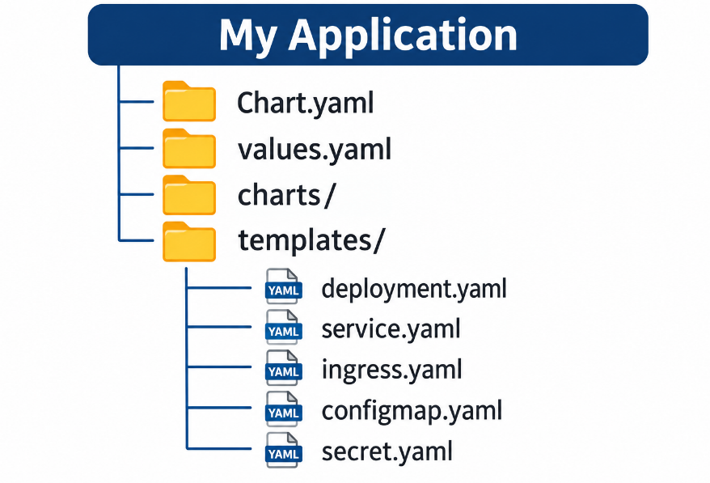

| **File**    | **Purpose**                       |
|-------------|-----------------------------------|
| Chart.yaml  | Chart name, version, and metadata |
| values.yaml | Default application configuration |
| templates/  | Kubernetes YAML templates         |
| charts/     | Dependencies on other Helm charts |

**Important:** A Helm chart can install several Kubernetes resources together. For example, installing PostgreSQL can create a StatefulSet, Service, Secret, and PersistentVolumeClaim.

## 2. Popular Kubernetes Helm Packages

Here are some of the most useful Helm charts, organized by their purpose.

### A. Networking and traffic management

These packages allow users to access applications running inside Kubernetes.

[10 NGINX Interview Questions and Answers in 2023](https://images.openai.com/static-rsc-4/dOu-MYfkTQh3C4_DmRg_CT1nCfFpOGkFkVmlFrqJBCfmLCSy5xu5_jaQQM8ueyMCU9WVGptDKQo53a2_kuq0YYJS9R8g9Nlh57LLZtU8Qy9qKSbRzJD4j734fZ5EWtTtdCT5L0Fl3KpytKBGoUrXPa-ZjnG7uk5Wzm1-8yXicK4?purpose=inline)

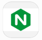 **1. NGINX Ingress Controller**

<span class="mark">Networking</span>

Routes external HTTP/HTTPS traffic to Kubernetes Services.

Example: A user visits https://myapp.example.com, and NGINX routes the request to your application.

Common use: Hosting multiple web applications behind one entry point.

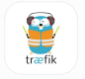**2. Traefik**

<span class="mark">Networking</span>

Reverse proxy and application traffic router.

Features:

- Automatic service discovery

- HTTPS integration

- Load balancing

- Routing rules

Alternative to traditional Ingress controllers.

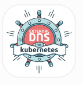 **3. ExternalDNS**

<span class="mark">DNS</span>

Automatically manages DNS records for Kubernetes Services and Ingress resources.

Example: Automatically creates a DNS record for myapp.example.com in a supported DNS provider.

### B. Security and certificates

These packages help protect your applications and manage HTTPS certificates.

[Cert Manager // Support Tools](https://images.openai.com/static-rsc-4/_SIgpFfp_YHDvl9JGeJfVWlfNH9NhQbecefJB9jXAWO6-zO1t_kWEReeJtRG74M57BeYYYdriTkO9UDtdw3pYldfnWitQbTDFBVyzvLYhXYv4ILCXk-k5rysxeHpj9lzO8YOwAhz3VGnIShbJtPw6hI8OvVwkY7uthec-Bs9vwY?purpose=inline)

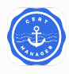**4. Cert-Manager**

<span class="mark">Security</span>

Automatically obtains, renews, and manages TLS/SSL certificates.

Example: Automatically requests and renews Let's Encrypt certificates for your website.

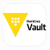**5. HashiCorp Vault**

<span class="mark">Security</span>

Securely stores and manages sensitive information.

Examples:

- Database passwords

- API keys

- Application secrets

- Encryption keys

Helps applications retrieve secrets without hardcoding credentials.

### C. Monitoring and observability

These packages help you understand what is happening inside your Kubernetes cluster.

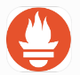**6. Prometheus**

<span class="mark">Monitoring</span>

Collects and stores metrics from Kubernetes nodes, pods, and applications.

Examples:

- CPU usage

- Memory usage

- Network traffic

- Application performance

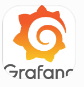**7. Grafana**

<span class="mark">Dashboards</span>

Displays metrics using visual dashboards and graphs.

Example: View CPU and memory consumption for every Kubernetes node.

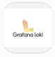**8. Loki**

Logging

Collects and stores application and Kubernetes logs.

Example: Search logs to troubleshoot why a Java Spring Boot application crashed.

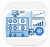**9. Metrics Server**

Monitoring

Collects basic CPU and memory usage metrics from Kubernetes nodes and pods.

Used by:

- kubectl top nodes

- kubectl top pods

- Horizontal Pod Autoscaler (HPA)

**Important:** kube-prometheus-stack is another particularly popular Helm chart. It bundles Prometheus, Grafana, Alertmanager, and supporting monitoring components. You can install it instead of installing each monitoring component separately.

### D. Continuous deployment and DevOps

These packages help automate application deployment.

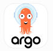**10. Argo CD**

<span class="mark">GitOps</span>

Automatically deploys Kubernetes applications from Git repositories.

Example:

1.  Developer pushes changes to GitHub.

2.  Argo CD detects the changes.

3.  Argo CD updates Kubernetes.

4.  The cluster matches the Git configuration.

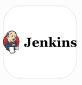**11. Jenkins**

<span class="mark">CI/CD</span>

Automates software building, testing, and deployment.

Example: Build a Java Spring Boot application, create a Docker image, and deploy it to Kubernetes.

### E. Databases and data storage

These charts install database systems inside your Kubernetes cluster.

**12. PostgreSQL**

<span class="mark">Database</span>

Relational database for storing structured application data.

Example: Store users, orders, transactions, and application information.

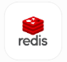**13. Redis**

<span class="mark">Cache</span>

In-memory data store used for caching, sessions, and queues.

Example: Cache frequently requested information to improve application performance.

**14. Longhorn**

<span class="mark">Storage</span>

Provides persistent distributed block storage for Kubernetes.

Example: Keep database data even when a database pod is restarted.

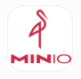**15. MinIO**

<span class="mark">Object storage</span>

Provides S3-compatible object storage.

Example: Store AI model files, documents, images, and datasets.

### F. Artificial intelligence and machine learning

These packages are especially interesting when building a local AI Kubernetes environment.

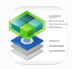**16. NVIDIA GPU Operator**

<span class="mark">AI / GPU</span>

Automates the installation and management of NVIDIA GPU software components in Kubernetes.

Responsibilities include:

- NVIDIA GPU device plugin

- NVIDIA Container Toolkit

- GPU drivers (when configured to manage them)

- GPU monitoring

Allows eligible Kubernetes workloads to request NVIDIA GPUs.

NVIDIA GPU Operator+1

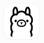**17. Ollama**

<span class="mark">Local AI</span>

Runs large language models locally.

Examples:

- Llama

- Qwen

- Gemma

Provides an API that applications can use to communicate with local AI models.

Note: Ollama is an application, not a Kubernetes Helm chart itself. Community Helm charts can deploy it.

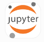**18. JupyterHub**

<span class="mark">Machine learning</span>

Provides browser-based Jupyter Notebook environments for data science and machine learning.

Example: Run Python, PyTorch, TensorFlow, and machine learning experiments in Kubernetes.

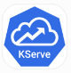**19. KServe**

<span class="mark">AI deployment</span>

Deploys and serves machine learning models on Kubernetes.

Example: Deploy a trained model and expose an HTTP inference endpoint for applications.

## 3. Quick reference: Which Helm package should you use?

| **Package**         | **Main purpose**  | **Typical use**               |
|---------------------|-------------------|-------------------------------|
| NGINX               | Networking        | Route web traffic             |
| Traefik             | Networking        | Reverse proxy                 |
| ExternalDNS         | DNS               | Manage DNS records            |
| Cert-Manager        | Security          | HTTPS certificates            |
| Vault               | Security          | Manage secrets                |
| Prometheus          | Monitoring        | Collect metrics               |
| Grafana             | Dashboards        | Visualize metrics             |
| Loki                | Logging           | Collect logs                  |
| Metrics Server      | Monitoring        | CPU and RAM metrics           |
| Argo CD             | GitOps            | Automated deployment          |
| Jenkins             | CI/CD             | Build and deploy applications |
| PostgreSQL          | Database          | Relational data               |
| Redis               | Cache             | Fast data access              |
| Longhorn            | Storage           | Persistent volumes            |
| MinIO               | Storage           | S3-compatible storage         |
| NVIDIA GPU Operator | AI infrastructure | GPU integration               |
| Ollama              | Local AI          | Run LLMs                      |
| JupyterHub          | AI development    | Python notebooks              |
| KServe              | AI deployment     | Model inference               |

## 4. How to install Helm packages

Helm uses repositories to find and install charts.

For example, let's install Prometheus and Grafana.

### Step 1. Add the Prometheus Helm repository

```bash
helm repo add prometheus-community 
```

<https://prometheus-community.github.io/helm-charts>

### Step 2. Update repositories

```bash
helm repo update
```

### Step 3. Search for available charts

```bash
helm search repo Prometheus
```

### Step 4. Install the monitoring stack

```bash
helm install monitoring \
  prometheus-community/kube-prometheus-stack \
  --namespace monitoring \
  --create-namespace
```
### Step 5. Check installed packages

```bash
helm list -A
```

### Step 6. Check Kubernetes pods

```bash
kubectl get pods -n monitoring
```

**Step 7. Uninstall**

```bash
helm uninstall monitoring -n monitoring
```

### 5. Popular Helm repositories

These are useful repositories to know.

| **Repository** | **Contains** |
|----|----|
| [Artifact Hub](https://artifacthub.io/?utm_source=chatgpt.com) | Search for Helm charts |
| [Prometheus Community](https://github.com/prometheus-community/helm-charts?utm_source=chatgpt.com) | Prometheus and Grafana |
| [Argo Helm](https://github.com/argoproj/argo-helm?utm_source=chatgpt.com) | Argo CD |
| [Jetstack](https://charts.jetstack.io/?utm_source=chatgpt.com) | Cert-Manager |
| [Grafana](https://grafana.github.io/helm-charts?utm_source=chatgpt.com) | Grafana and Loki |
| [NVIDIA NGC](https://helm.ngc.nvidia.com/?utm_source=chatgpt.com) | NVIDIA GPU Operator |

You can find thousands of community and vendor-published charts in Artifact Hub.

# [README](./../../README.md)
