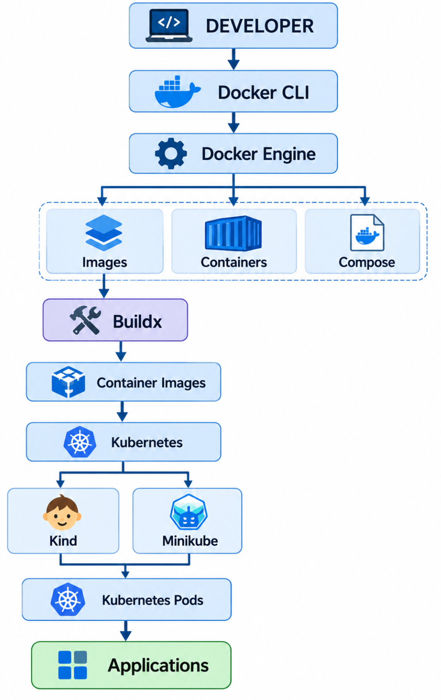

# Understanding Docker and Kubernetes

## 1. Introduction

Docker and Kubernetes are important technologies used in modern software development, DevOps, cloud computing, and application deployment.

Although these tools work together, they have different responsibilities.

- **Docker** builds and runs containers.
- **Docker Compose** manages multiple containers.
- **Docker Buildx** builds container images.
- **containerd** manages container execution.
- **Kubernetes** orchestrates containers across multiple machines.
- **Kind** runs Kubernetes clusters inside Docker containers.
- **Minikube** creates a local Kubernetes learning and development environment.

---

# 2. Docker Engine

## What is Docker Engine?

Docker Engine is the software that builds, runs, and manages containers.

It allows developers to package applications and their dependencies into portable containers.

### Main components

| Component | Responsibility |
|---|---|
| Docker CLI | Accepts commands from users |
| Docker daemon | Manages Docker operations |
| containerd | Manages container lifecycle |
| runc | Creates and runs containers |

### Example

Run an NGINX web server:

```bash
docker run -d -p 8080:80 nginx
```

Explanation:

- `docker run`: Creates and starts a container.
- `-d`: Runs in the background.
- `-p 8080:80`: Maps host port 8080 to container port 80.
- `nginx`: Container image.

Open your browser:

```text
http://localhost:8080
```

### When to use Docker Engine

- Running application containers.
- Developing applications.
- Building container images.
- Testing software.
- Preparing applications for Kubernetes.

---

# 3. Docker Desktop

## What is Docker Desktop?

Docker Desktop is a graphical application that provides Docker Engine and additional development tools.

It includes:

- Graphical user interface.
- Container management.
- Image management.
- Docker Compose integration.
- Kubernetes integration (optional).
- Extensions.

### Docker Engine vs. Docker Desktop

| Feature | Docker Engine | Docker Desktop |
|---|---|---|
| Command-line interface | Yes | Yes |
| Graphical interface | No built-in GUI | Yes |
| Container management | Yes | Yes |
| Image management | Yes | Yes |
| Docker Compose | Plugin | Included |
| Kubernetes integration | External setup | Optional built-in |
| Resource overhead | Generally lower | Generally higher |

### When to use Docker Desktop

- You prefer graphical management.
- You want to inspect containers visually.
- You are developing applications locally.

**Recommendation:** Use Docker Engine on Debian VMware to keep your environment lightweight.

---

# 4. Docker Compose

## What is Docker Compose?

Docker Compose manages multiple containers using one YAML configuration file.

Instead of starting each container individually, you define your application services in `compose.yaml`.

### Example application

Imagine an application containing:

1. Web application.
2. Database.
3. Redis cache.

Create a file:

```bash
nano compose.yaml
```

Add:

```yaml
services:

  web:
    image: nginx
    ports:
      - "8080:80"

  database:
    image: postgres:17
    environment:
      POSTGRES_PASSWORD: example
    volumes:
      - postgres-data:/var/lib/postgresql/data

  redis:
    image: redis:alpine

volumes:
  postgres-data:
```

Start all services:

```bash
docker compose up -d
```

Check running containers:

```bash
docker compose ps
```

Stop the application:

```bash
docker compose down
```

### When to use Docker Compose

- Local application development.
- Multi-container applications.
- Development databases.
- Testing microservices.
- Local development environments.

---

# 5. Docker Buildx

## What is Docker Buildx?

Docker Buildx is an advanced image-building tool.

It extends the standard Docker image-building capabilities using BuildKit.

It supports:

- Multi-platform builds.
- Build caching.
- Parallel builds.
- Advanced build configurations.
- Image publishing.

### Example

Build an image:

```bash
docker buildx build -t myapp:1.0 .
```

Build for multiple architectures:

```bash
docker buildx build \
  --platform linux/amd64,linux/arm64 \
  -t myapp:1.0 \
  --push .
```

### When to use Buildx

- Building production images.
- Supporting AMD64 and ARM64.
- Optimizing image builds.
- Creating CI/CD pipelines.

---

# 6. containerd

## What is containerd?

containerd is a container runtime responsible for managing container execution and lifecycle.

It handles operations such as:

- Downloading container images.
- Managing container storage.
- Creating containers.
- Starting and stopping containers.
- Managing container execution.

Docker Engine uses containerd internally.

Kubernetes can also use containerd directly through the Container Runtime Interface (CRI).

### Docker Engine vs. containerd

| Feature | Docker Engine | containerd |
|---|---|---|
| User-friendly CLI | Yes | Not primarily |
| Container lifecycle | Yes | Yes |
| Image management | Yes | Yes |
| Docker Compose | Yes | No |
| Application builds | Yes | Not its primary purpose |
| Kubernetes integration | Via runtime integration | Direct CRI support |

### When to use containerd

- Kubernetes environments.
- Production container infrastructure.
- Container runtime management.
- Lightweight container platforms.

---

# 7. Kubernetes

## What is Kubernetes?

Kubernetes is an open-source container orchestration platform.

It automates the deployment, scaling, networking, and management of containerized applications.

Docker runs containers individually, while Kubernetes manages containerized applications across a cluster.

### Main Kubernetes components

| Component | Responsibility |
|---|---|
| API Server | Central Kubernetes API |
| etcd | Stores cluster configuration |
| Scheduler | Assigns workloads to nodes |
| Controller Manager | Maintains desired cluster state |
| Kubelet | Manages workloads on each node |
| kube-proxy | Provides service networking rules |

### Important Kubernetes objects

| Object | Purpose |
|---|---|
| Pod | Smallest deployable workload |
| Deployment | Manages application replicas |
| Service | Provides stable network access |
| ConfigMap | Stores application configuration |
| Secret | Stores sensitive configuration |
| Namespace | Separates cluster resources |
| PersistentVolume | Provides persistent storage |

### Example

Deploy NGINX:

```bash
kubectl create deployment nginx --image=nginx
```

Expose the application:

```bash
kubectl expose deployment nginx \
  --port=80 \
  --type=NodePort
```

Check deployments:

```bash
kubectl get deployments
```

Check pods:

```bash
kubectl get pods
```

### When to use Kubernetes

- Managing multiple applications.
- Running microservices.
- Scaling applications.
- Managing production workloads.
- Automated application deployment.
- High-availability infrastructure.

---

# 8. Kind (Kubernetes in Docker)

## What is Kind?

Kind stands for Kubernetes in Docker.

It creates Kubernetes clusters using Docker containers as Kubernetes nodes.

Instead of requiring several virtual machines, Kind runs your Kubernetes cluster inside Docker.

### Example

Create a cluster:

```bash
kind create cluster --name dev-cluster
```

Check the cluster:

```bash
kubectl get nodes
```

Delete the cluster:

```bash
kind delete cluster --name dev-cluster
```

### Multi-node cluster

Kind supports multiple Kubernetes nodes.

Example configuration:

```yaml
kind: Cluster
apiVersion: kind.x-k8s.io/v1alpha4

nodes:
  - role: control-plane
  - role: worker
  - role: worker
```

Create the cluster:

```bash
kind create cluster \
  --name multi-node \
  --config kind-config.yaml
```

### When to use Kind

- Kubernetes development.
- Learning Kubernetes.
- Testing Kubernetes configurations.
- CI/CD pipelines.
- Multi-node Kubernetes simulations.

---

# 9. Minikube

## What is Minikube?

Minikube is a tool that creates and manages a local Kubernetes cluster.

It is designed primarily for learning Kubernetes and local development.

It supports several drivers, including Docker and virtual machines.

### Example

Start a Kubernetes cluster:

```bash
minikube start --driver=docker
```

Check cluster status:

```bash
minikube status
```

Open Kubernetes Dashboard:

```bash
minikube dashboard
```

Stop the cluster:

```bash
minikube stop
```

Delete the cluster:

```bash
minikube delete
```

### When to use Minikube

- Learning Kubernetes.
- Practicing Kubernetes commands.
- Exploring Kubernetes Dashboard.
- Testing application deployments.
- Learning Kubernetes add-ons.

---

# 10. Kind vs. Minikube

These tools solve a similar problem but have different strengths.

| Feature | Kind | Minikube |
|---|---|---|
| Local Kubernetes | Yes | Yes |
| Docker support | Yes | Yes |
| Multi-node clusters | Yes | Yes |
| Dashboard | External setup | Built-in add-on |
| Add-ons | Limited built-in features | Extensive add-ons |
| CI/CD testing | Excellent | Supported |
| Learning Kubernetes | Excellent | Excellent |
| Resource usage | Generally lightweight | Depends on driver and configuration |

### Which one should you choose?

**Choose Kind if:**
- You already have Docker installed.
- You want lightweight Kubernetes clusters.
- You want to practice multi-node clusters.
- You want to test Kubernetes deployments.

**Choose Minikube if:**
- You want a Kubernetes learning environment.
- You want an integrated dashboard.
- You want to explore Kubernetes add-ons.
- You prefer a guided local development experience.

---

# 11. How Everything Works Together

Here is a simplified architecture:





Note: Kind and Minikube are alternative ways to create local Kubernetes clusters. They are not components that Kubernetes requires. Docker Engine is not required by Kubernetes itself.

---

# 12. Comparison Summary

| Technology | Main Purpose | Category |
|---|---|---|
| Docker Engine | Run containers | Container engine |
| Docker Desktop | Graphical Docker environment | Development platform |
| Docker Compose | Manage multiple containers | Container orchestration |
| Docker Buildx | Build container images | Image builder |
| containerd | Manage container execution | Container runtime |
| Kubernetes | Manage containerized applications | Orchestration |
| Kind | Run local Kubernetes clusters | Kubernetes tool |
| Minikube | Run local Kubernetes clusters | Kubernetes tool |
| kubectl | Communicate with Kubernetes | Command-line tool |
| Helm | Package and deploy Kubernetes applications | Package manager |

---

# 13. Recommended Debian Development Environment

For a Debian 13 VMware machine, I recommend this installation order:

| Order | Software | Purpose |
|---|---|---|
| 1 | Docker Engine | Container management |
| 2 | Docker Compose | Multi-container applications |
| 3 | Docker Buildx | Image building |
| 4 | kubectl | Kubernetes management |
| 5 | Kind | Local Kubernetes clusters |
| 6 | Helm | Kubernetes application deployment |

## Final Recommendation

Start with Docker Engine and Docker Compose.

Then install kubectl, Kind, and Helm.

This gives you a practical development environment for:

- Docker container development.
- Kubernetes administration.
- Microservices.
- CI/CD pipelines.
- DevOps automation.
- Cloud-native application development.

## Official Documentation

- Docker: https://docs.docker.com/
- Docker Compose: https://docs.docker.com/compose/
- Docker Buildx: https://docs.docker.com/build/buildx/
- containerd: https://containerd.io/
- Kubernetes: https://kubernetes.io/docs/
- Kind: https://kind.sigs.k8s.io/
- Minikube: https://minikube.sigs.k8s.io/docs/
- Helm: https://helm.sh/docs/

# [README](./../../README.md)
