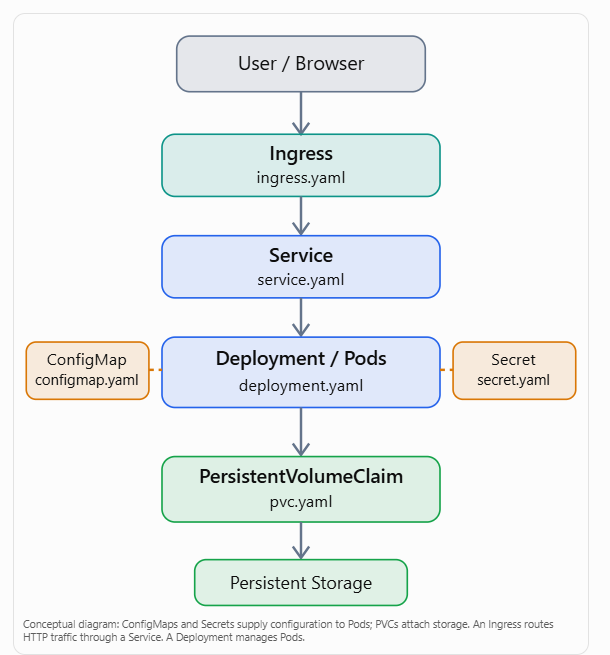

# YAML Files Explained

Kubernetes YAML Files Explained: When and How to Use Deployment, Service, ConfigMap, Secret, PVC, and Ingress

In Kubernetes, you use deployment.yaml, service.yaml, configmap.yaml, secret.yaml, pvc.yaml, and ingress.yaml to configure, deploy, connect, and manage applications running inside a Kubernetes cluster.

You do not always need all six files. Each file has a different responsibility.

For example, suppose you are building an application with:

- Angular — Frontend web application

- MongoDB — Database

- Kubernetes (kind) — Local Kubernetes cluster

- Docker — Container images

**1. When do you use each Kubernetes YAML file?**

| **YAML file** | **When to use it** | **Example** |
|----|----|----|
| deployment.yaml | When you need Kubernetes to run and manage application containers | Run Angular with 3 replicas |
| service.yaml | When containers need stable networking or other applications need to connect to them | Angular connects to a backend |
| configmap.yaml | When you need to store non-sensitive configuration outside container images | API URL, application environment |
| secret.yaml | When your application needs sensitive information | MongoDB username and password |
| pvc.yaml | When your application needs persistent storage | Keep MongoDB data after a Pod restarts |
| ingress.yaml | When you want HTTP/HTTPS access through a hostname or URL path | Access Angular at angular.local |

**2. How the Kubernetes files work together**

**3. Examples of each YAML file**

**A. deployment.yaml — Run your application**

Use a Deployment when you want Kubernetes to create and maintain application Pods, restart failed containers, and support scaling.

Example: Run two Angular containers.

ymal

apiVersion: apps/v1

kind: Deployment

metadata:

name: angular-app

spec:

replicas: 2

selector:

matchLabels:

app: angular

template:

metadata:

labels:

app: angular

spec:

containers:

\- name: angular

image: my-angular-app:1.0

ports:

\- containerPort: 80

replicas: 2 tells Kubernetes to maintain two Angular Pods. The image must be available to your cluster.

**B. service.yaml — Connect to your application**

Pods can be replaced, and their IP addresses can change. A Service provides a stable way to reach matching Pods.

ymal

apiVersion: v1

kind: Service

metadata:

name: angular-service

spec:

type: ClusterIP

selector:

app: angular

ports:

\- port: 80

targetPort: 80

ClusterIP makes the Service available inside the cluster. For local testing, you can forward a port:

kubectl port-forward svc/angular-service 8080:80

Then open http://localhost:8080.

**C. configmap.yaml — Store configuration**

Use a ConfigMap for application settings that are not secret.

ymal

apiVersion: v1

kind: ConfigMap

metadata:

name: app-config

data:

NODE_ENV: "production"

API_URL: <http://backend-service:3000>

You can reference these values from a Pod's environment or mount them as files. For Angular, remember that browser-side configuration often needs to be built into the frontend or served through a runtime configuration file.

**D. secret.yaml — Store sensitive values**

Use Secrets for passwords, tokens, and other sensitive configuration.

ymal

apiVersion: v1

kind: Secret

metadata:

name: mongodb-secret

type: Opaque

stringData:

MONGO_INITDB_ROOT_USERNAME: "admin"

MONGO_INITDB_ROOT_PASSWORD: "replace-me"

stringData allows you to supply plain text and lets Kubernetes encode the stored values. However, Kubernetes Secrets are not automatically encrypted at rest, and this example should not be committed to Git with a real password.

**E. pvc.yaml — Keep your database data**

Use a PersistentVolumeClaim when application data must survive Pod replacement.

ymal

apiVersion: v1

kind: PersistentVolumeClaim

metadata:

name: mongodb-pvc

spec:

accessModes:

\- ReadWriteOnce

resources:

requests:

storage: 5Gi

MongoDB can mount this claim at /data/db. The cluster needs a compatible storage provisioner or existing PersistentVolume. For a production MongoDB deployment, a StatefulSet is generally more suitable than a Deployment.

**F. ingress.yaml — Access your application by hostname**

Use an Ingress when you want to route HTTP or HTTPS traffic to your Service.

ymal

apiVersion: networking.k8s.io/v1

kind: Ingress

metadata:

name: angular-ingress

spec:

rules:

\- host: angular.local

http:

paths:

\- path: /

pathType: Prefix

backend:

service:

name: angular-service

port:

number: 80

This requires an installed Ingress controller, DNS or hosts-file resolution for angular.local, and networking that makes the controller reachable. Creating the YAML file alone does not expose the application.

**4. Which files do you need for Angular and MongoDB?**

| **Kubernetes resource** | **Angular** | **MongoDB**        |
|-------------------------|-------------|--------------------|
| Deployment              | Yes         | Prefer StatefulSet |
| Service                 | Yes         | Yes                |
| ConfigMap               | Optional    | Optional           |
| Secret                  | Usually no  | Yes                |
| PVC                     | Usually no  | Yes                |
| Ingress                 | Optional    | Usually no         |

For Angular, the minimum is typically a Deployment and Service. For MongoDB, you generally need a StatefulSet, Service, Secret, and persistent storage.

**5. How do you deploy the files?**

If your YAML files are stored in a k8s folder, you can apply them together:

bash

kubectl apply -f k8s/

Or apply them individually:

bash

kubectl apply -f configmap.yaml

kubectl apply -f secret.yaml

kubectl apply -f pvc.yaml

kubectl apply -f deployment.yaml

kubectl apply -f service.yaml

kubectl apply -f ingress.yaml

Check the Kubernetes resources:

bash

kubectl get pods

kubectl get deployments

kubectl get services

kubectl get configmaps

kubectl get secrets

kubectl get pvc

kubectl get ingress

Important: You don't need to create all these files for every application. Start with a Deployment and Service, then add configuration, secrets, storage, and external routing when your application requires them.

# [README](./../../../README.md)
